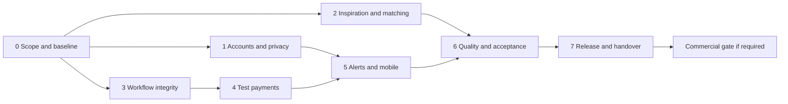

# Inside: phased project completion plan

Prepared: 17 October 2026. Companion analysis: [PROJECT_ANALYSIS.md](PROJECT_ANALYSIS.md).

## 1. Finish line

Recommended target: a complete, evaluated academic release with a usable web marketplace, a defined mobile companion, real account emails and native alerts, and a reliable Stripe test-mode payment lifecycle. Preserve the existing stack and complete the implemented workflows.

Real-money collection, escrow and designer payouts are a separate release gate. If the authoritative marking criteria require actual settlement rather than a test-mode demonstration, the commercial gate becomes mandatory; the project must remain explicitly partial until it passes. A narrowed scope must be agreed and documented, not silently described as complete.

### Academic release is complete when

- Every FR01–FR20 requirement has an acceptance test, implementation reference, status and evidence, or an explicitly approved scope exception.
- A new client and designer can complete the agreed journey without database edits, developer tokens or undocumented manual steps.
- Account emails are delivered; native notification behavior is verified on the target device(s).
- Inspiration produces an editable brief with useful context and explainable recommendations.
- Competing workflow actions cannot produce inconsistent decisions, duplicate projects or duplicate milestone records.
- Test payments reconcile without browser-return dependence; UI distinguishes delivery progress, payment confirmation and demo release.
- Web and mobile release artifacts pass the agreed acceptance matrix, and known limits are published.
- CI passes from a clean checkout, deployed revision is identified, and rollback plus backup/restore are demonstrated in an isolated environment.
- Independent evaluation, technical documentation, user guides and dissertation claims match the final system.

## 2. Sequence and effort

Effort estimates assume one developer familiar with this codebase, focused working days, and access to the required accounts/devices. They are planning estimates, not deadlines. External approvals, infrastructure problems and assessment scheduling add elapsed time.

| Phase | Outcome | Depends on | Estimated effort |
| --- | --- | --- | --- |
| 0 | Frozen scope and repeatable baseline | None | 1–2 days |
| 1 | Usable account recovery and defined privacy boundaries | 0 | 3–5 days |
| 2 | Complete inspiration/discovery/matching journey | 0; authenticated smoke tests after 1 | 3–4 days |
| 3 | Consistent hiring/project state transitions | 0 and policy decisions | 3–5 days |
| 4 | Reliable test-mode milestone finance | 3 | 3–5 days |
| 5 | External alerts and completed mobile companion | 1, 3, 4 contracts | 4–6 days |
| 6 | Measured quality, security, operations and user acceptance | 1–5; tests start in every phase | 4–6 days |
| 7 | Traceable deployment, documentation and submission | 6 | 2–4 days |
| Commercial gate | Real-money marketplace | 7 plus provider feasibility and business decisions | Estimate after feasibility review |

Core estimate: **23–37 focused developer days**. With roughly 25% contingency, plan approximately **29–47 working days**, plus external lead time. Re-estimate after Phase 0 and after payment tests. Full native web parity is excluded from this estimate.

## Phase 0 — Freeze scope and restore a repeatable baseline

**Goal:** remove uncertainty about what must be finished and make verification safe to repeat.

- [ ] P0.1 Recover authoritative proposal/interim requirements; use the existing FR01–FR20 matrix as the starting point. Record source version and requirement owner.
- [ ] P0.2 Decide and document mobile companion versus full native parity. Recommended: keep discovery/hiring/admin on web, with useful contextual web handoffs from mobile.
- [ ] P0.3 Decide payment timing: funding before stage work versus payment after approved delivery; distinguish delivery completion from financial closure. Recommended intended target: funded stages in test mode, without claiming escrow or actual payouts.
- [ ] P0.4 Record decisions on cancellation/refund behavior, free stages, verification meaning, review moderation and unavailable designers. Existing proposals need an explicit policy when availability changes after submission.
- [ ] P0.5 Repair local pinned pnpm execution, start an isolated PostgreSQL service, and document separate dev, API-test, UI-test and staging database URLs. Never point reset/seed tests at user data.
- [ ] P0.6 Run the existing unit, API database and browser suites. Capture failures, revision and environment before writing more features. The new directory tests need their first actual browser execution.
- [ ] P0.7 Make root checks explicit for every package: API typecheck script, non-mutating API lint, mobile typecheck/lint and appropriate API/web build gates. Produce a real mobile build separately.
- [ ] P0.8 Record local versus deployed commits and applied migrations. Preserve existing staged work; do not assume the Vercel page contains recent fixes.
- [ ] P0.9 Start a requirement-to-test evidence ledger and a small prioritized defect register. Reuse existing tests and documents rather than duplicating them.

**Deliverables:** scope matrix, decision log, environment/setup guide, baseline test report.

**Exit gate:** a clean setup can run repeatable checks against expendable databases; every requirement has an agreed release target and a test owner. Unknown deployment parity is explicitly resolved or tracked.

## Phase 1 — Complete accounts, recovery and privacy boundaries

**Goal:** users can access and recover their accounts, and private content has an intentional access policy.

- [ ] P1.1 Introduce a transactional-email interface and configurable provider. Send verification and reset links using the correct public origin; retain secure hashed, expiring, single-use tokens.
- [ ] P1.2 Add resend verification with throttling, delivery retry/failure handling and a clear status UI. Preserve generic forgot-password responses without falsely claiming completed delivery.
- [ ] P1.3 Verify registration → delivered email → verification, and forgotten password → delivered link → reset → old-session revocation. Test expired, reused and malformed links.
- [ ] P1.4 Define which actions require email verification; enforce that rule on the API and explain it in web/mobile UI. Do not confuse email verification with professional designer verification.
- [ ] P1.5 Improve browser session storage through a documented server-managed/HttpOnly refresh-session design. Preserve mobile secure storage; add CSRF controls if cookie-based authentication is introduced. Test refresh races, logout and multi-tab behavior.
- [ ] P1.6 Separate public portfolio media from private deliverables, message attachments and verification evidence. Implement authorized retrieval/short-lived access for private files where required; verify unauthenticated URLs cannot bypass the intended policy.
- [ ] P1.7 Add upload size limits, failure feedback, ownership binding, file-type validation and cleanup/retention rules. Validate provider settings rather than assuming folder names create privacy.
- [ ] P1.8 Add privacy, terms, support and data-retention information. Define deletion/export requests without destroying required project/payment history. Obtain appropriate review before real customer use.
- [ ] P1.9 Test reporter access to private targets and derive reported-party attribution from server-owned records. Confirm admin and outsider boundaries across private content.

**Primary code:** API `auth`, `users`, `uploads`, `reports`; web auth pages/session provider; mobile session/link handling.

**Exit gate:** real delivered recovery links work without developer token copying; revoked sessions fail; the private-file access matrix is verified; user-facing promises match actual behavior.

## Phase 2 — Complete inspiration, discovery and matching

**Goal:** a client's visual choices survive into a useful brief and relevant designer results.

- [ ] P2.1 Preserve source portfolio IDs and notes when saving inspiration. Add item editing/context display where missing; keep externally uploaded inspiration usable without forcing a portfolio link.
- [ ] P2.2 Generate suggested styles/rooms from linked portfolio metadata. Ask the client to confirm conflicting choices; let them select values for unlinked images. Keep generated text editable.
- [ ] P2.3 Replace silent Mixed/General fallbacks with an explicit incomplete-brief state or a documented broad-search fallback. Do not add image AI merely to fill this gap.
- [ ] P2.4 Normalize budget min/max and currency; migrate existing free-text ranges safely with review of unparseable values. Explain historical portfolio budgets separately from service fees.
- [ ] P2.5 Preserve and test current explainable matching. Add cases for no description, no budget, unknown styles, no candidates, blocked/unavailable/suspended designers and description-only relevance.
- [ ] P2.6 Decide whether reverse matching of open requests to designers remains a requirement. If so, add explainable fit ranking with a newest-first alternative; otherwise record it as future work.
- [ ] P2.7 Finish consistency across public browsing: persist portfolio filters/pagination in URLs, preserve return context and improve empty/error/retry behavior. Verify the recent designer directory changes before changing them again.
- [ ] P2.8 Render initial public directory/profile/portfolio data on the server where practical and add eligible detail URLs to the sitemap. Verify titles, canonical URLs, sharing images and missing-record behavior.
- [ ] P2.9 Create a small representative labelled brief/designer evaluation set with an assessor's relevance judgments. Record ranking quality and difficult cases; do not present heuristic scores as calibrated probabilities.

**Primary code:** API `moodboards`, `briefs`, `matching`, `requests`; web moodboards, brief editor, public designers/portfolios and metadata.

**Exit gate:** a saved room portfolio produces a brief containing its useful context; the client can edit it and receive explainable eligible matches. Shared discovery URLs survive refresh and Back. Ranking evaluation has recorded results.

## Phase 3 — Make hiring and project transitions reliable

**Goal:** competing actions and retries preserve one coherent project history.

- [ ] P3.1 Write a transition table for requests, proposals, projects, stages and verification decisions: actor, allowed previous states, new state, side effects and conflict response.
- [ ] P3.2 Preserve existing transactional proposal acceptance and conditional stage approval. Extend conditional writes to competing rejection/withdrawal, request cancellation/closure, stage submit/reject/start, project hold/resume/cancel and verification approval/rejection.
- [ ] P3.3 Coordinate stage decisions with project state in the transaction. Reproduce approval versus project cancellation/hold before selecting locking or isolation behavior.
- [ ] P3.4 Persist hold actor/time/reason as authoritative project state. Keep activity history for display, not as the only source of authorization for resume.
- [ ] P3.5 Allocate deliverable versions safely under concurrent uploads, with a unique constraint plus retry/locking strategy and a useful conflict message.
- [ ] P3.6 Enforce milestone uniqueness and currency/amount invariants for the agreed model. Inspect/migrate existing records; avoid destructive reset migrations.
- [ ] P3.7 Define cancellation's effect on pending work, already paid milestones and outstanding decisions. Make the same policy visible on web and mobile.
- [ ] P3.8 Persist critical business/audit events transactionally or through a durable outbox. Preserve best-effort behavior for noncritical display events only where acceptable.
- [ ] P3.9 Exercise real database concurrency: two accepts, approve versus reject, approve versus cancel, two versions, two verification decisions and retry after a dropped response.

**Primary code:** API `requests`, `proposals`, `projects`, `stages`, `deliverables`, `verifications`, `activity`; Prisma migrations; corresponding UI actions.

**Exit gate:** competing actions have one valid winner; losing actions return a controlled conflict; no duplicate project/payment/version side effects occur; retry does not corrupt history.

## Phase 4 — Complete reliable milestone payments in test mode

**Goal:** demonstrate the agreed financial lifecycle without real-money claims or dependence on a return tab.

- [ ] P4.1 Implement the Phase 0 funding rule. If funding precedes work, create milestones on proposal acceptance and gate stage start appropriately; do not keep creating the same payment again on stage approval. Define zero-fee stages explicitly.
- [ ] P4.2 Add a narrowly scoped public webhook endpoint with provider signature verification against the raw request body. Keep ordinary payment-management endpoints authenticated.
- [ ] P4.3 Store event/session identities and handle repeated, delayed and out-of-order events idempotently. Validate expected milestone, amount, currency and completed payment state before updating records.
- [ ] P4.4 Reuse a valid Checkout session or apply a stable idempotency strategy. Prevent two payable sessions from collecting twice for the same milestone.
- [ ] P4.5 Treat the browser return as a status-refresh convenience. Add a reconciliation path for missing/failed webhooks and clear pending/failed/cancelled states.
- [ ] P4.6 Separate delivery progress, payment balance and demo release approval in the UI. A completed delivery must not imply that all money has been settled.
- [ ] P4.7 Test successful payment, closing the browser, cancellation, expiration, delayed confirmation, duplicate webhook, invalid signature, wrong amount/currency, repeat checkout and replayed confirmation.
- [ ] P4.8 Define refund behavior for the academic demo. Implement a test-mode refund if it is in the agreed scope; otherwise state that cancellation does not automatically refund and keep that requirement explicitly partial.
- [ ] P4.9 Keep live keys rejected. Retain the explicit statement that recording release does not transfer money to a designer.

**Primary code:** API `payments`, `main.ts` raw-body handling, stages/proposal integration, Prisma event/session records, web/mobile payment status.

**Exit gate:** confirmed test payment reaches the correct milestone without a browser return; duplicate events/retries cannot duplicate collection or transitions; financial status is honest and traceable. This gate does not certify escrow or actual payout.

## Phase 5 — Finish alerts and the mobile companion

**Goal:** clients and designers can manage an ongoing project from a phone and receive actionable alerts.

- [ ] P5.1 Reuse the email service for agreed transactional alerts, with preferences and appropriate message content. Do not send private file content in notifications.
- [ ] P5.2 Add device-token registration/removal, notification permission handling, delivery retries, provider receipt processing and invalid-token cleanup. Define behavior for denied permissions and logged-out users.
- [ ] P5.3 Make notification taps open the correct accessible project/stage/message. Test cold launch, app background, foreground and expired session.
- [ ] P5.4 Add mobile email verification/recovery links and safe handoffs to the web for companion-only functions. Preserve intended destination through sign-in.
- [ ] P5.5 Make the test-payment handoff actionable and refresh status on return; replace the current text-only direction. Do not duplicate the financial business logic in the app.
- [ ] P5.6 Verify mobile stages, upload cancellation, file opening, revision feedback, messaging, older-message loading and role switching. Add task/date actions only where the agreed companion scope requires them.
- [ ] P5.7 Handle network loss, retry, refresh, app resume and logout races. Confirm unread counts and display errors instead of presenting failed requests as empty success states.
- [ ] P5.8 Move a small stable set of response types/enums into shared contracts or generated types, then add contract tests for changed API responses.
- [ ] P5.9 Produce an installable target-platform artifact with environment configuration, versioning and native smoke tests. Add mobile type/lint checks and suitable behavioral coverage to CI.

**Primary code:** API `notifications` and device registrations; mobile app config/routes/session/project components; shared contracts.

**Exit gate:** a target-device user receives and opens a real test notification, completes the agreed revision/message journey, survives reconnect/sign-out, and can follow the test-payment web handoff. Missing optional native parity is documented.

## Phase 6 — Measure quality and prove release readiness

**Goal:** replace assumptions with repeatable evidence.

- [ ] P6.1 Run the full API/database/browser suite against isolated services and a candidate build. Run browser paths on desktop and phone widths; record failures and fix them before sign-off.
- [ ] P6.2 Test keyboard navigation, form names, focus, menu/dialog behavior, contrast, dynamic announcements, zoom, reduced motion and horizontal overflow. Use automated checks plus manual review.
- [ ] P6.3 Define representative data volume and load. Measure public browsing, matching, messages, admin lists and workspace actions; report p50/p95 and error rates with hardware/data/concurrency context.
- [ ] P6.4 Set quality targets before recording results. Suggested project-specific targets: zero critical accessibility findings in the accepted journeys; zero unauthorized access in the negative matrix; no invalid state after concurrency tests; at least 90% completion of agreed UAT tasks. Review performance targets after the baseline rather than inventing achieved scores.
- [ ] P6.5 Add pagination/stable ordering where list limits hide records; use server-side aggregate counts for dashboards instead of counting one fetched page. Check relevant query plans/indexes with the measured data.
- [ ] P6.6 Review dependencies, secret handling, production configuration, CORS, rate limits behind the actual proxy, private media and CSP. Test authorization using a second client/designer, not only the intended account.
- [ ] P6.7 Add useful structured errors, correlation IDs, operational metrics and alerts for API/database/email/webhook failures. Prove that simulated failures become visible to the operator.
- [ ] P6.8 Rehearse database backup and restore into a new isolated database, migration deployment and application rollback. Record recovery time and data-loss expectations rather than claiming an untested SLA.
- [ ] P6.9 Recruit representative volunteer clients/designers for independent UAT. Obtain appropriate consent, use test data, record task results, feedback and unresolved limitations. Add admin evaluation separately.
- [ ] P6.10 Evaluate recommendation relevance on the labelled set from Phase 2 and compare a simple baseline. Report errors and sampling limits; do not equate deterministic unit tests with matching accuracy.

**Exit gate:** all mandatory acceptance tests pass, no unresolved release-blocking defect remains, agreed quality targets have measured results, and limitations have an owner and disposition.

## Phase 7 — Deploy, document and hand over

**Goal:** deliver one reproducible release whose code, evidence and documentation agree.

- [ ] P7.1 Build API/container, production web and native artifact from the same tagged revision; record dependency lockfile and migration version. Verify configured origins, HTTPS and callback URLs.
- [ ] P7.2 Deploy through staging first, apply reviewed migrations, run safe smoke checks and verify the deployed revision. Promote using the existing hosting approach unless a platform change is justified.
- [ ] P7.3 Keep production data and demo fixtures separate. QA accounts with published portfolios can still become discoverable: use a separate QA environment and an explicit test-account/publication mechanism where needed.
- [ ] P7.4 Write setup, configuration, architecture/ERD, API, testing, backup/restore, migration/rollback, integration limitations and support runbooks. Keep secrets and token-bearing test fixtures out of shared artifacts.
- [ ] P7.5 Write role-specific user guides: client briefing/hiring/approval, designer proposals/delivery, admin verification/moderation, and mobile companion limits.
- [ ] P7.6 Update dissertation FR/NFR matrices, diagrams, screenshots and testing/evaluation chapters. Mark old hosted checks as historical; clearly label new measurements, blocked checks and approved scope exceptions.
- [ ] P7.7 Demonstrate the release from a clean client account through completion, then verify moderation and recovery paths. Archive a sanitized evidence pack and known-issues list.

**Exit gate:** source tag, deployed version, mobile artifact, migration state, evidence pack and documentation identify the same release. A second person can set up or use the system from the supplied instructions.

## Commercial gate — Required before accepting real money

This gate is optional only if the accepted project scope is explicitly a test-mode academic release.

- Confirm provider/account/country/currency and marketplace-payout eligibility using current official provider documentation before choosing a settlement design.
- Define who receives funds, fees, payout timing, disputes, cancellation, refunds and support responsibility. Do not describe an internal status field as escrow.
- Implement supported designer onboarding, account eligibility, transfers/payouts and reconciliation. Keep payment collection, release approval and payout confirmation as distinct events.
- Implement refunds, failures, disputes, duplicate events, charge reconciliation and operational recovery; verify the required controls in a provider sandbox before a tightly controlled live launch.
- Complete the relevant business/privacy/security review, financial monitoring, retention and incident procedures.
- Remove the live-key block only after the gate is satisfied and the actual launch is authorized. Completion of earlier phases does not authorize live financial operations.

## 3. Acceptance journey checklist

Use fresh test accounts and an isolated database. Record the revision, environment, result and evidence for each journey.

| Journey | Required proof |
| --- | --- |
| J01 Account lifecycle | Register, delivered verification, resend, recovery, token expiry/reuse, revoked sessions and suspended login |
| J02 Designer onboarding | Update profile, publish work, directory eligibility, availability and verification criteria |
| J03 Discovery | Style/location/availability filters, result counts, URL refresh, Back and no-result recovery |
| J04 Visual brief | Save linked/unlinked inspiration, confirm inferred context, edit brief and handle concurrent edits |
| J05 Matching | Eligible explained results, incomplete input fallback, blocked/unavailable exclusion and labelled relevance results |
| J06 Hiring | Direct/open request, proposal comparison, decline/withdraw/resubmit and availability-change policy |
| J07 Acceptance race | Competing decisions create exactly one project with five ordered stages |
| J08 Delivery | Start, tasks/dates where in scope, upload versions, reject with reason, revise, approve and prevent future-stage access |
| J09 Project control | Hold/resume ownership, cancel policy and simultaneous cancellation/approval |
| J10 Finance | Test Checkout, browser closed, webhook replay/failure, wrong amount/currency and no duplicate collection |
| J11 Communication | Two-party messages, read/unread state, old pages under new arrivals and authorized file access |
| J12 External alerts/mobile | Real delivered test email/push, notification destination and native reconnect/deep-link behavior |
| J13 Trust/admin | Private evidence, outsider denial, verification conflict, report resolution, review moderation and rating updates |
| J14 Operations | Fresh deployment, migrations, health failure visibility, backup restore and rollback |
| J15 Independent evaluation | UAT task completion, accessibility checks, representative performance and recommendation relevance |

Tests that mock upload or email responses do not replace actual provider smoke tests. Tests that create financial states directly do not prove a payment or payout occurred.

## 4. Working rules and scope control

- Keep implementation changes small enough to review and verify per phase; do not wait until Phase 6 to test.
- Preserve working acceptance/approval guards and add targeted regressions before refactoring them.
- Do not rerun destructive seeds against the deployed database. The seed's NODE_ENV guard is useful but does not prove the selected database is expendable.
- Keep existing version-controlled changes intact; use the current work as the baseline, not a fresh rewrite.
- Defer full native parity, image-understanding AI, WebSocket chat, broad architectural replacement and advanced analytics unless an agreed requirement or measured failure makes them necessary.
- Polling can satisfy the current messaging scope; label its behavior honestly and measure it before replacing it.
- Maintain one requirement ledger with statuses: implemented, verified, partial, blocked or approved out of scope. A task is done only when its exit evidence exists.

## 5. First implementation batch

1. Restore the isolated PostgreSQL/pinned-pnpm setup and run existing database/browser suites.
2. Freeze the companion and funding policies; record any authoritative scope conflict.
3. Implement delivered verification/reset emails and resend behavior.
4. Fix inspiration-to-brief context and add the incomplete-matching fallback.
5. Reproduce the priority transition races in PostgreSQL before changing their transaction boundaries.

Start Phase 0 first. The current unit baseline and recent directory fixes should be preserved and verified, not rebuilt.
