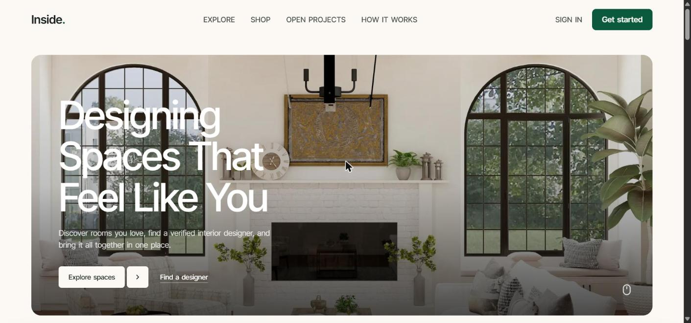
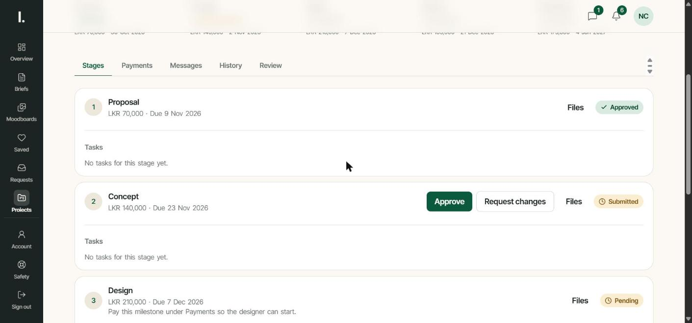

# Inside

**Interior design marketplace — portfolio discovery, visual briefs, staged collaboration, milestone payments.**

[-green)]()
[]()
[]()
[]()
[]()

**Live demo:** [www.insidesign.me](https://www.insidesign.me)

**Done by MNSBaanu**

## Overview

Inside is a full-stack platform that connects **clients** and **interior designers** in one workflow. Clients browse completed room projects, build moodboards, submit structured briefs, hire designers, and approve work at each stage. Designers publish portfolios, respond to requests, and deliver concepts through a stage-gated workspace. Milestone payments are a Stripe test-mode demonstration; releasing a milestone records approval and does not transfer money to a designer.



---

## Features

- **Portfolio discovery** — search and filter designers by style, room type, and budget
- **Moodboards & briefs** — visual inspiration boards that generate editable project briefs, with an optional AI brief assistant (Gemini)
- **Designer matching** — fit scoring and ranked, explainable recommendations
- **Hiring** — open requests, direct invites, proposals, and side-by-side comparison
- **Project workspace** — staged flow (Proposal → Concept → Design → Revision → Completion) with files, tasks, history, and reviews
- **Messaging & notifications** — live chat (Socket.IO), in-app notifications, and transactional email (Resend); push on mobile
- **Milestone payment demo** — Stripe test-mode Checkout and approval records; no escrow or designer payouts
- **Shop** — product catalogue and product pages
- **Opt-in dual-role accounts** — every account starts with one role; a designer can create a client account and a client can create a designer account from Account, then switch `activeRole` CLIENT ↔ DESIGNER
- **Trust & admin** — verification, reviews, reports, moderation, analytics with PDF export, announcements, and newsletter



---

## Documentation

- [User Manual](docs/User_Manual.docx) — how clients, designers, and administrators use the platform
- [Technical Documentation](docs/Technical_Documentation.docx) — architecture, setup, security, data model, API reference, testing, and deployment

---

## Tech Stack

| Layer | Stack |
|-------|-------|
| Web | Next.js 15, React 19, Clerk 7, TypeScript, Tailwind CSS |
| Mobile | Expo / React Native, TypeScript |
| API | Node.js, NestJS 11, Prisma, Socket.IO |
| Database | PostgreSQL |
| Media | Cloudinary |
| Email | Resend |
| AI | Google Gemini (brief assistant) |
| Payments | Stripe (test mode) |
| Hosting | Vercel (web), Render (API), Neon (database) |
| Tooling | pnpm, Turborepo, Git, GitHub Actions, Jest, Vitest, Playwright, Postman, Swagger |

---

## Project Structure

```
apps/
  api/       NestJS API (src/modules: identity, discovery, hiring, delivery, trust, platform)
  web/       Next.js web app (app/, components/, lib/)
  mobile/    Expo mobile companion
packages/
  database/  Prisma schema, migrations, seed
  eslint-config/
```

---

## Getting Started

Requires Node.js, pnpm, and a local PostgreSQL database. Copy the example environment files in `apps/api`, `apps/web`, and `packages/database`, then set the database URL and any service keys you want to use.

```bash
pnpm install
pnpm --filter @inside/database exec prisma migrate dev
pnpm --filter @inside/database db:seed   # demo accounts
pnpm dev                                 # run all apps
```

| Command | Purpose |
|---------|---------|
| `pnpm typecheck` | Type-check the workspace |
| `pnpm lint` | Lint the workspace |
| `pnpm test` | Unit tests (Jest for the API, Vitest for the web) |
| `pnpm --filter api test:e2e` | API integration tests (needs Postgres) |
| `pnpm --filter web exec playwright test` | Browser tests |
| `pnpm build` | Production build |

The API serves Swagger documentation for its routes.

---

## CI and deployment

- **CI:** GitHub Actions runs typecheck, lint, tests, and build on pushes to `main` and on pull requests.
- **Deploy:** pushes to `main` deploy the web app to Vercel and the API to Render, against a Neon PostgreSQL database.
- **Seeding:** the `Seed production` workflow loads demo data; resetting production requires typing `WIPE` to confirm.

---

## Database backups

- **Nightly dump:** the `Backup database` workflow runs `pg_dump` against the live Neon database every night at 02:00 Sri Lanka time, and on demand from the Actions tab.
- **Where it is stored:** each dump is saved as a workflow artifact (`inside-<date>.dump`) on that run's page in GitHub Actions, kept for 30 days, and visible only to repository collaborators.
- **Point-in-time restore:** Neon's own history restore covers very recent mistakes.
- **Not included:** uploaded files live in Cloudinary and are not part of the dump.

To restore, download the artifact, unzip it, then load it into an empty database (a new Neon branch or local Postgres):

```bash
pg_restore --no-owner --no-acl --clean --if-exists -d "<database url>" inside-<date>.dump
```

---

## License

All rights reserved. Academic project
