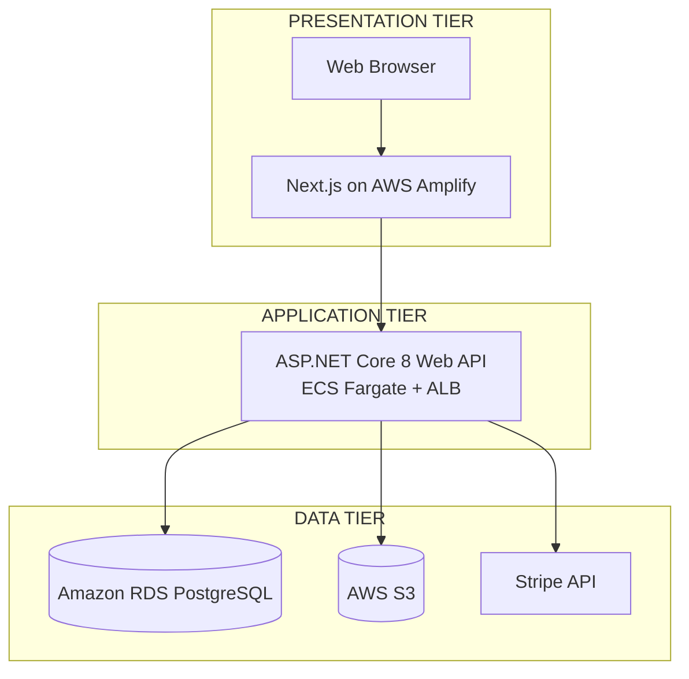
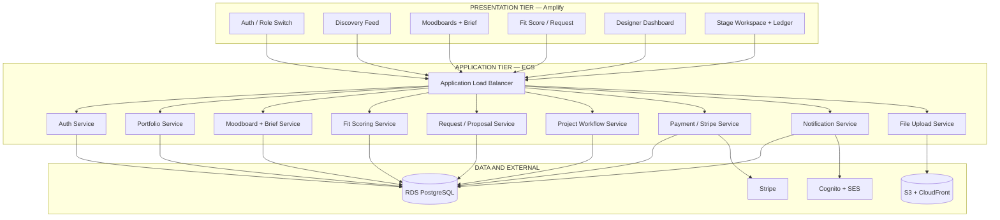

# Proposed Solution

The proposed solution is **Inside**, an interior design service platform that goes beyond a generic freelance marketplace by combining **visual brief intelligence**, **designer–client fit scoring**, and **stage-gated collaboration** with milestone payments—all within a single AWS-hosted environment.

## Core functional areas (approved topic)

**Portfolio-first discovery** enables clients to browse completed room case studies with filters for design style, room type, and budget band—hiring decisions based on demonstrated work, not text-only profiles.

**Moodboards and structured briefs** let clients save portfolio projects to personal moodboards. The system **automatically generates a structured design brief** (dominant styles, room types, suggested budget band) from moodboard contents, giving designers clarity before work begins.

**Designer–client fit scoring** ranks designers by **visual compatibility** with the client’s moodboard (style, room type, budget overlap)—not generic star ratings alone.

**Project requests and proposals** support open hiring: clients post requirements with moodboard + auto-brief; designers submit scope, timeline, price, and milestones; clients accept the best fit.

**Stage-gated project workspace** organises delivery into interior-design stages—Proposal → Concept → Design → Revision → Completion—with **deliverables and approvals per stage** (primary workflow); messaging supports feedback but is secondary to stage files.

**Transparent milestone ledger** shows each stage’s amount, payment status, and approval timestamps. Stripe processes payments when the client approves a gated stage.

**Dual-role accounts**, designer availability, in-app and email notifications (AWS SES), and post-completion reviews complete the platform loop.

---

## Final Year innovation (differentiation)

| Layer | Feature | Why it is not “generic freelancing” |
|-------|---------|-----------------------------------|
| **A — Brief intelligence** | Auto brief from moodboard tags | Replaces vague text job posts with formalised visual intent |
| **B — Fit score** | % match moodboard ↔ designer portfolio | Ranks by demonstrated visual fit, not reviews only |
| **C — Stage workspace** | Tabs per stage; approve/reject deliverables | Mirrors interior design workflow, not a message thread |
| **D — Milestone ledger** | Audit trail of stage payments | Transparent escrow-style progression |

Comparison positioning (Houzz / Fiverr / Havenly) is documented in [supporting/literature-domain-review.md](supporting/literature-domain-review.md).

---

## Architecture approach

Three-tier architecture on **AWS**:

| Tier | Technology |
|------|------------|
| Presentation | Next.js 14, TypeScript, Tailwind CSS — **AWS Amplify** |
| Application | **ASP.NET Core 8 Web API** — **AWS ECS Fargate** + ALB |
| Data | **Amazon RDS (PostgreSQL)**, **S3**, **CloudFront**, **Stripe**, **Cognito**, **SES**, **Secrets Manager**, **CloudWatch** |

Backend uses **Clean Architecture**: `Inside.Api` → `Inside.Application` (brief + fit scoring services) → `Inside.Domain` → `Inside.Infrastructure` (EF Core, S3, Stripe adapters).

Full diagrams: **[diagrams/architecture-diagrams.md](diagrams/architecture-diagrams.md)**.

---

## Architecture Diagrams

### Figure 1 — Simple three-tier architecture

Browser → Next.js (Amplify) → ASP.NET Core API (ECS) → RDS PostgreSQL / S3 / Stripe.

*Figure 1: Simple three-tier architecture of Inside*

---

### Figure 2 — Detailed high-level architecture

*Figure 2: Detailed high-level architecture of Inside*

---

### Architecture summary table

| Tier | Components | Technology |
|------|------------|------------|
| Presentation | Discovery, moodboards, brief, fit score, dashboards, stage workspace | Next.js 14, AWS Amplify |
| Application | REST API, brief engine, fit scoring, workflow, payments | ASP.NET Core 8, ECS Fargate |
| Data | Relational data, media, payments, identity, email | RDS PostgreSQL, S3, CloudFront, Stripe, Cognito, SES |

**Further reading**

| Topic | Document |
|-------|----------|
| Flows & concepts | [SYSTEM-OVERVIEW.md](../SYSTEM-OVERVIEW.md) |
| Architecture detail | [diagrams/architecture-diagrams.md](diagrams/architecture-diagrams.md) |
| Technology rationale | [supporting/technology-justification.md](supporting/technology-justification.md) |
| Functional requirements | [supporting/functional-requirements.md](supporting/functional-requirements.md) |
| Evaluation plan | [supporting/evaluation-plan.md](supporting/evaluation-plan.md) |
