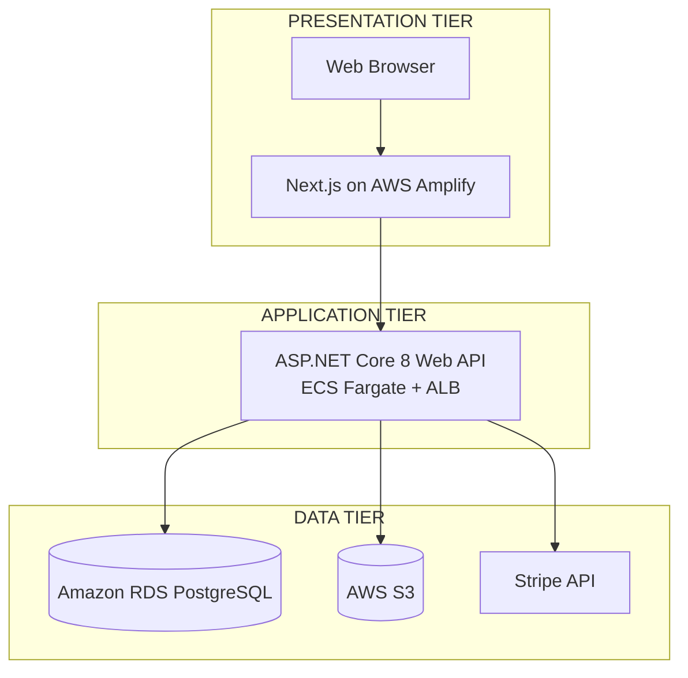
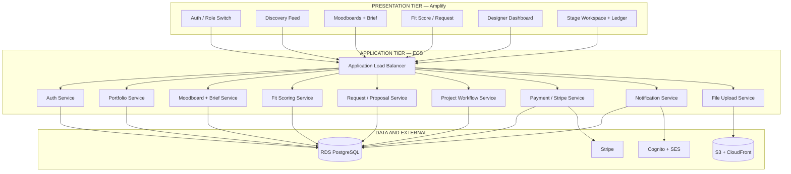

# Proposed Solution

The proposed solution is **Inside**, an interior design service platform that goes beyond a generic freelance marketplace by combining **visual brief intelligence**, **designer–client fit scoring**, and **stage-gated collaboration** with milestone payments—all within a single AWS-hosted environment.

## Core functional areas (approved topic)

**Portfolio-first discovery** enables clients to browse completed room case studies with filters for design style, room type, and budget band.

**Moodboards and structured briefs** let clients save portfolio projects to moodboards. The system **automatically generates a structured design brief** (dominant styles, room types, suggested budget band) from moodboard contents.

**Designer–client fit scoring** ranks designers by **visual compatibility** with the client’s moodboard (style, room type, budget overlap).

**Project requests and proposals** support open hiring with moodboard + auto-brief attached.

**Stage-gated project workspace** uses stages Proposal → Concept → Design → Revision → Completion, with deliverables and approvals per stage.

**Transparent milestone ledger** records stage amounts, payment status, and approval timestamps via Stripe.

**Dual-role accounts**, availability, notifications (SES), and reviews complete the platform.

---

## Final Year innovation

| Layer | Feature | Differentiation |
|-------|---------|-----------------|
| A — Brief intelligence | Auto brief from moodboard | Formalised visual intent vs text job posts |
| B — Fit score | % match moodboard ↔ portfolio | Visual fit vs star ratings only |
| C — Stage workspace | Per-stage deliverables + approval | ID workflow vs generic chat |
| D — Milestone ledger | Payment audit trail | Transparent stage-gated pay |

---

## Functional requirements (summary)

### Authentication (FR-AUTH)

Register/login (Cognito); dual-role (client/designer); dashboard switch; JWT role claims on API.

### Portfolio and discovery (FR-PORT, FR-DISC)

Designer publishes case studies (style, room, budget); public feed with filters.

### Moodboards (FR-MOOD)

Create boards; save portfolio items; attach board to request.

### Structured brief — Layer A (FR-BRIEF)

| ID | Requirement |
|----|-------------|
| FR-BRIEF-01 | Generate structured brief from moodboard |
| FR-BRIEF-02 | Include dominant styles with proportions |
| FR-BRIEF-03 | Include room types represented |
| FR-BRIEF-04 | Suggest budget band |
| FR-BRIEF-05 | Brief visible to client before posting |
| FR-BRIEF-06 | Brief attached to request for designers |
| FR-BRIEF-07 | MVP: rule-based tag aggregation |

### Fit score — Layer B (FR-FIT)

| ID | Requirement |
|----|-------------|
| FR-FIT-01 | Fit score 0–100% per designer for a moodboard |
| FR-FIT-02 | Uses style, room, budget overlap |
| FR-FIT-03 | Client views ranked designers before posting |
| FR-FIT-04 | Algorithm documented for dissertation evaluation |

### Hiring, workspace, payments (FR-HIRE, FR-PROJ, FR-PAY)

Requests and proposals; accept → project; five stages with S3 deliverables; client approves stages; Stripe milestones; ledger UI; webhooks update state.

### Reviews and notifications (FR-REV, FR-NOT, FR-AVAIL)

Post-completion reviews; in-app + SES notifications; designer availability status.

---

## Scope and limitations

**MVP:** Cognito auth, portfolio + discovery, moodboards + brief, fit scoring, requests/proposals, stage workspace, Stripe ledger, reviews, AWS deployment.

**Phase 2:** AWS Rekognition labels, WebSocket chat, Stripe Connect payouts, deliverable annotations.

**Limitations:** Stripe test mode; rule-based brief; English UI; single AWS region.

---

## Architecture approach

| Tier | Technology |
|------|------------|
| Presentation | Next.js 14 — **AWS Amplify** |
| Application | **ASP.NET Core 8 Web API** — **ECS Fargate** + ALB |
| Data | **RDS PostgreSQL**, S3, CloudFront, Stripe, Cognito, SES |

Clean Architecture: `Inside.Api` → `Inside.Application` (BriefService, FitScoringService) → `Inside.Domain` → `Inside.Infrastructure`.

Diagrams: [diagrams/architecture-diagrams.md](diagrams/architecture-diagrams.md). Flows: [SYSTEM-OVERVIEW.md](../SYSTEM-OVERVIEW.md).

---

## Architecture Diagrams

### Figure 1 — Simple three-tier architecture

*Figure 1: Simple three-tier architecture of Inside*

---

### Figure 2 — Detailed high-level architecture

*Figure 2: Detailed high-level architecture of Inside*

---

## Key API endpoints (ASP.NET Core)

| Group | Examples |
|-------|----------|
| Auth | `POST /api/v1/auth/login` |
| Portfolios | `GET /api/v1/portfolios` |
| Moodboards | `GET /api/v1/moodboards/{id}/brief` |
| Fit | `GET /api/v1/moodboards/{id}/fit-scores` |
| Requests / Proposals | `POST /api/v1/requests`, `PATCH /api/v1/proposals/{id}/accept` |
| Projects | `POST /api/v1/projects/{id}/stages/{stage}/approve` |
| Ledger | `GET /api/v1/projects/{id}/ledger` |
| Payments | `POST /api/v1/payments/webhook` |
