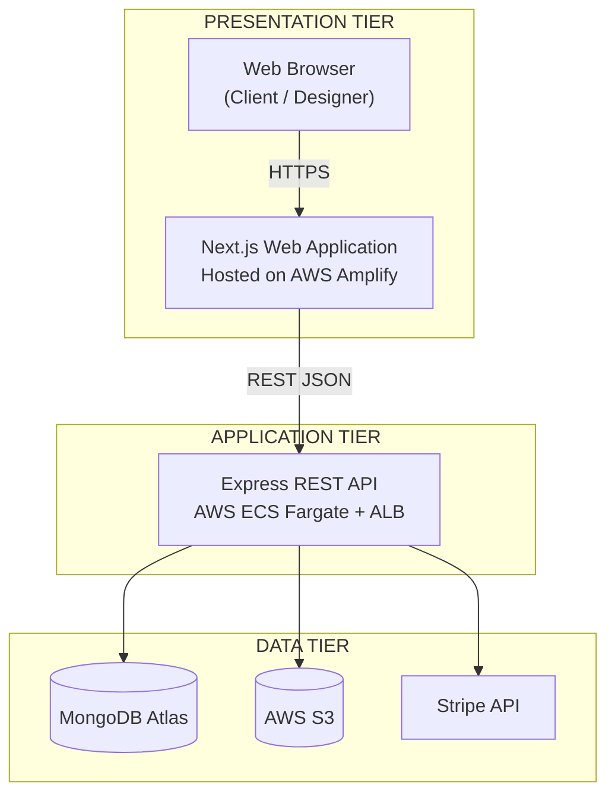
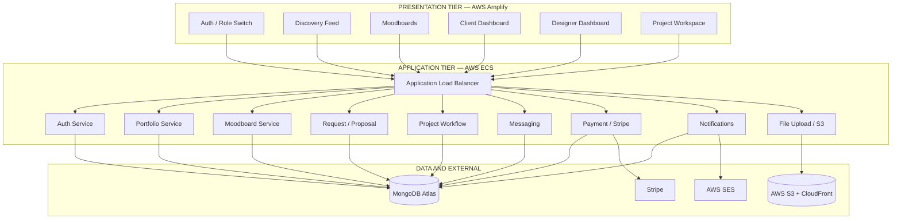

# Proposed Solution

The proposed solution is **Inside**, a role-based interior design service platform that digitises the complete client–designer journey within a single cloud-hosted web environment. The system integrates eight core functional areas into a centralised platform.

**Portfolio-first discovery** enables clients to browse completed interior design projects (case studies) published by designers, with filtering by design style, room type, and budget range. This replaces profile-only hiring decisions with demonstrated work.

**Moodboard and visual brief** functionality allows clients to save preferred portfolio projects to personal moodboards and attach them when creating project requests, giving designers a visual reference before work begins.

**Project requests and proposals** support open marketplace hiring: clients post requirements; designers respond with scope of work, estimated timeline, and pricing; clients evaluate and accept the most suitable proposal. Direct hire from a portfolio project is also supported.

**Structured project workspace** organises active work into interior-design-specific stages — Proposal, Concept, Design, Revision, and Completion — with messaging and file sharing for deliverables (floor plans, renders, concept boards) stored on AWS S3 and delivered via CloudFront.

**Milestone-based payment processing** divides the total project fee into stages (e.g. 30% / 40% / 30%). Payments are processed through Stripe when the client approves each stage, improving transparency and trust.

**Dual-role account management** allows one user to operate as both client and designer with separate dashboards, enforced by role-based access control on the API.

**Designer availability and notifications** keep designers able to signal availability status and keep both parties informed of proposals, messages, approvals, and payments through in-app notifications and AWS SES email.

**Reviews and ratings** after project completion build designer reputation on the platform and close the service loop.

The platform uses a **three-tier architecture**: Next.js presentation layer (AWS Amplify), Express REST API application layer (AWS ECS Fargate), and data layer (MongoDB Atlas, Amazon S3, Stripe). This integrated solution reduces fragmented tooling, supports clearer visual communication, and delivers a structured interior design service experience for clients and designers.

---

## Architecture Diagrams

The system follows a **three-tier architecture** separating presentation, application logic, and data storage. Full diagrams, module tables, and export steps: **[diagrams/architecture-diagrams.md](diagrams/architecture-diagrams.md)**.

> **Note:** High-level diagrams are optional per the lecturer template but are included here for a production-grade cloud project.

### Figure 1 — Simple three-tier architecture

Browser → Next.js (AWS Amplify) → Express API (AWS ECS) → MongoDB Atlas / S3 / Stripe.

*Figure 1: Simple three-tier architecture of Inside* — export PNG from [architecture-diagrams.md](diagrams/architecture-diagrams.md).

---

### Figure 2 — Detailed high-level architecture

Modules per tier: six UI areas (presentation); nine API services behind ALB (application); MongoDB, S3, CloudFront, Stripe, SES, Cognito, Secrets Manager, CloudWatch (data/external).

*Figure 2: Detailed high-level architecture of Inside* — export PNG from [architecture-diagrams.md](diagrams/architecture-diagrams.md).

---

### Architecture summary table

| Tier | Components | Technology |
|------|------------|------------|
| Presentation | Discovery, moodboards, dashboards, project workspace | Next.js 14, TypeScript, Tailwind CSS on **AWS Amplify** |
| Application | REST API, auth, workflow, payments, uploads | **Node.js**, **Express** on **AWS ECS Fargate** + ALB |
| Data | Database, files, payments, email, secrets | **MongoDB Atlas**, **S3**, **CloudFront**, **Stripe**, **SES**, **Secrets Manager**, **CloudWatch** |

Additional design detail (ER diagram, use cases, API list): see [supporting/system-design.md](supporting/system-design.md).
