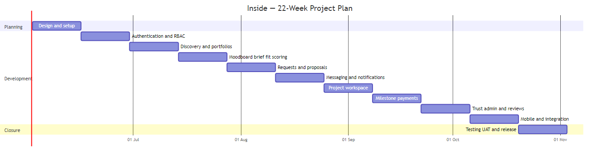

# Project Plan

**Total duration:** 13 weeks

## Stages and approximate times

| Stage | Activities | Duration |
|-------|------------|----------|
| 1 | Research and requirement analysis | 2 weeks |
| 2 | System design (diagrams, ER, wireframes) | 1 week |
| 3 | Database design and AWS setup | 1 week |
| 4 | Frontend development | 3 weeks |
| 5 | Backend development (.NET API) | 3 weeks |
| 6 | Stripe integration and testing | 2 weeks |
| 7 | Evaluation and documentation | 1 week |

### Detailed week breakdown

| Week(s) | Task |
|---------|------|
| 1–2 | Research, requirements, proposal |
| 3 | System design, architecture diagrams |
| 4 | RDS/EF Core design, AWS baseline |
| 5 | Auth, dual-role (Cognito) |
| 6–7 | Portfolio, S3, discovery feed |
| 7–8 | Moodboards, structured brief, fit scoring |
| 8 | Requests and proposals |
| 9–10 | Stage workspace, deliverables |
| 10–11 | Stripe milestones, ledger, SES, reviews |
| 12 | Integration testing, UAT |
| 13 | Evaluation, dissertation, demo |

---

## Evaluation plan

Demonstrate innovation beyond a generic marketplace through **brief quality**, **fit score usefulness**, and **stage-gated workflow**.

### Functional evaluation

| Criterion | Method | Target |
|-----------|--------|--------|
| FR coverage | Checklist in [06-proposed-solution.md](06-proposed-solution.md) | ≥ 90% MVP pass |
| End-to-end journey | Test scenarios TS-01–TS-12 (below) | All critical pass |
| Payments | Stripe vs ledger in RDS | Amounts match |

### Brief intelligence (Layer A)

- Expert review: brief reflects moodboard (Likert 1–5, n=3–5)
- Designers rate clarity vs text-only request
- API brief generation &lt; 2 seconds

### Fit score (Layer B)

- Compare user top-3 designer picks vs fit score ranking
- Survey: “Fit score helped me choose” (1–5)

### Stage workspace (Layer C)

- UAT: upload deliverable → approve → stage advances
- Preference vs messages-only mock

### Usability

- **SUS** survey (3–5 participants)
- Tasks: moodboard → brief → request → proposal → one milestone payment

### Technical

| Metric | Target |
|--------|--------|
| Discovery load (Lighthouse) | ≥ 70 |
| API p95 (non-upload) | &lt; 500 ms |

---

## Testing approach

| Level | Tool |
|-------|------|
| Unit | xUnit — BriefService, FitScoringService |
| Integration | WebApplicationFactory + test database |
| E2E | Playwright |
| API | Swagger / Postman |

### Critical test scenarios

| ID | Scenario |
|----|----------|
| TS-01 | Register client (Cognito) |
| TS-02 | Designer publishes portfolio |
| TS-03 | Discovery filters |
| TS-04 | Moodboard + brief generation |
| TS-05 | Fit scores for moodboard |
| TS-06 | Request with brief attached |
| TS-07 | Accept proposal → project |
| TS-08 | Upload stage deliverable |
| TS-09 | Approve stage + Stripe milestone |
| TS-10 | Full journey to review |
| TS-11 | Dual-role RBAC |
| TS-12 | Unauthorized access → 403 |

Stripe test card: `4242 4242 4242 4242`.

---

## Gantt Chart

```mermaid
gantt
    title Inside — 13-Week Project Plan
    dateFormat X
    axisFormat %s
    section Research
    Research and requirements           :a1, 0, 2
    section Design
    System design and wireframes        :a2, 2, 1
    Database API and AWS setup          :a3, 3, 1
    section Development
    Auth and dual-role                  :a4, 4, 1
    Portfolio and discovery feed        :a5, 5, 2
    Moodboards brief and fit score      :a6, 7, 1
    Requests and proposals              :a7, 8, 1
    Project workspace                   :a8, 9, 2
    Stripe and deliverables             :a9, 10, 2
    Reviews and notifications           :a10, 11, 1
    section Close
    Testing and UAT                     :a11, 12, 1
    Evaluation and documentation        :a12, 13, 1
```

*Figure 3: Gantt chart — Inside project schedule*

Export PNG to `diagrams/07-gantt-chart.png` — see [diagrams-and-charts-guide.md](diagrams-and-charts-guide.md).

### Supervisor checkpoints

| Week | Milestone |
|------|-----------|
| 2 | Proposal on ELMS |
| 4 | Design sign-off |
| 7 | Discovery + moodboard + brief demo |
| 11 | End-to-end + Stripe test payment |
| 13 | Final submission |
