# Project Plan

**Total duration:** 13 weeks

## Stages and approximate times

| Stage | Activities | Duration |
|-------|------------|----------|
| 1 | Research and requirement analysis | 2 weeks |
| 2 | System design (diagrams, ER model, wireframes) | 1 week |
| 3 | Database design and AWS environment setup | 1 week |
| 4 | Frontend development | 3 weeks |
| 5 | Backend development (ASP.NET Core API) | 3 weeks |
| 6 | Stripe integration and testing | 2 weeks |
| 7 | Evaluation and documentation | 1 week |

| Week(s) | Main tasks |
|---------|------------|
| 1–2 | Domain research, requirements, proposal finalisation |
| 3 | System design, architecture diagrams |
| 4 | Database schema, EF Core, AWS baseline |
| 5 | Authentication and user roles |
| 6–7 | Discovery, profiles, and media handling |
| 8 | Project requests and designer responses |
| 9–10 | Project workspace, deliverables, approvals |
| 10–11 | Stripe integration, notifications |
| 12 | Integration and user acceptance testing |
| 13 | Evaluation, dissertation, demonstration |

### Supervisor checkpoints

| Week | Milestone |
|------|-----------|
| 2 | Proposal submitted on ELMS |
| 4 | Design sign-off |
| 7 | Discovery and profiles demonstrable |
| 11 | End-to-end journey including test payment |
| 13 | Final submission |

---

## Gantt Chart

```mermaid
gantt
    title Interior Design Service Platform — 13-Week Plan
    dateFormat X
    axisFormat %s
    section Research
    Research and requirements           :a1, 0, 2
    section Design
    System design and wireframes        :a2, 2, 1
    Database and AWS setup              :a3, 3, 1
    section Development
    Auth and user roles                 :a4, 4, 1
    Discovery and profiles              :a5, 5, 2
    Requests and responses              :a6, 7, 1
    Project workspace                   :a7, 8, 2
    Payments and notifications          :a8, 10, 2
    section Close
    Testing and UAT                     :a9, 12, 1
    Evaluation and documentation        :a10, 13, 1
```

*Figure 3: Gantt chart — 13-week project schedule*

