# Project Plan

**Development methodology:** Agile (sprint-based)

**Total duration:** 13 weeks

| Sprint | Activities | Duration |
|--------|------------|----------|
| Sprint 1 | Requirements gathering (aligned to functional scope), domain research (Havenly, Decorilla, Houzz, etc.), technology evaluation, proposal | 2 weeks |
| Sprint 2 | System architecture, database design, UI wireframes (including admin), PostgreSQL/Cloudinary/Stripe/email setup, web and mobile scaffolding | 2 weeks |
| Sprint 3 | Authentication (register, login, logout, password reset, email verification), profiles, account settings, dual-role, RBAC (client, designer, admin) | 2 weeks |
| Sprint 4 | Portfolio discovery (feed, search, filters), favourites, moodboards, structured brief (generate + edit), fit scoring; web UI + mobile shell | 2 weeks |
| Sprint 5 | Open and direct requests, proposals, comparison; real-time messaging (read/unread), in-app and email notifications; mobile core flows | 2 weeks |
| Sprint 6 | Stage workspace (deliverables, versions, feedback, approve/reject, timeline, activity log), Stripe milestones and ledger, reviews, trust and safety (verify, report, block), admin moderation and analytics | 2 weeks |
| Sprint 7 | Testing, UAT, evaluation, bug fixes, documentation, deployment | 1 week |

### Key milestones

| Week | Milestone |
|------|-----------|
| 2 | Requirements and scope finalized; proposal on ELMS |
| 4 | Design sign-off; architecture diagrams exported |
| 6 | Auth, dual-role, and RBAC demonstrable |
| 8 | Discovery, search, moodboard, brief, fit score, and favourites demonstrable (web) |
| 10 | Requests, proposals, messaging, and notifications working (web + mobile) |
| 11 | End-to-end journey including workspace, Stripe test payment, reviews |
| 12 | Trust, safety, and admin flows demonstrable |
| 13 | Final testing, evaluation, dissertation, and demo |

---

## Evaluation plan

The dissertation will evaluate innovation beyond a generic marketplace through **brief quality**, **fit score usefulness**, and **stage-gated workflow** effectiveness.

| Criterion | Method | Target |
|-----------|--------|--------|
| Functional coverage | Checklist against objectives (12 capability areas) | ≥ 90% MVP features pass |
| End-to-end journey | Test scenarios: moodboard → brief → request → proposal → one milestone | All critical paths pass |
| Auth and access | Register, verify email, login, role switch, admin-only routes denied to clients | Pass |
| Discovery | Search, filter, favourite designer, view availability | Pass |
| Brief clarity | Likert survey (1–5): brief reflects moodboard; n = 3–5 volunteers | Mean ≥ 4 |
| Fit score usefulness | Compare user top-3 designer picks vs fit ranking; survey item | ≥ 70% alignment or mean ≥ 4 |
| Stage workflow | UAT: upload deliverable → feedback → approve → stage advances | Pass |
| Messaging | Send message, read/unread updates, project thread | Pass |
| Usability | SUS survey (3–5 participants) on core web tasks | Mean ≥ 68 |
| Payments | Stripe test payment vs ledger record | Amounts and status match |
| Trust and admin | Report flow, admin review action, verification status visible | Pass (MVP subset) |

---

## Gantt Chart

```mermaid
gantt
    title Interior Design Service Platform — 13-Week Plan
    dateFormat X
    axisFormat %s
    section Research
    Requirements and domain research    :a1, 0, 2
    section Design
    Architecture DB wireframes setup    :a2, 2, 2
    section Development
    Auth RBAC profiles settings         :a3, 4, 2
    Discovery moodboard brief fit         :a4, 6, 2
    Requests proposals messaging notify   :a5, 8, 2
    Workspace payments trust admin        :a6, 10, 2
    section Close
    Testing UAT evaluation docs         :a7, 12, 1
```

*Figure 3: Gantt chart — 13-week project schedule (export as PNG from draw.io or mermaid.live for inclusion in the proposal).*
