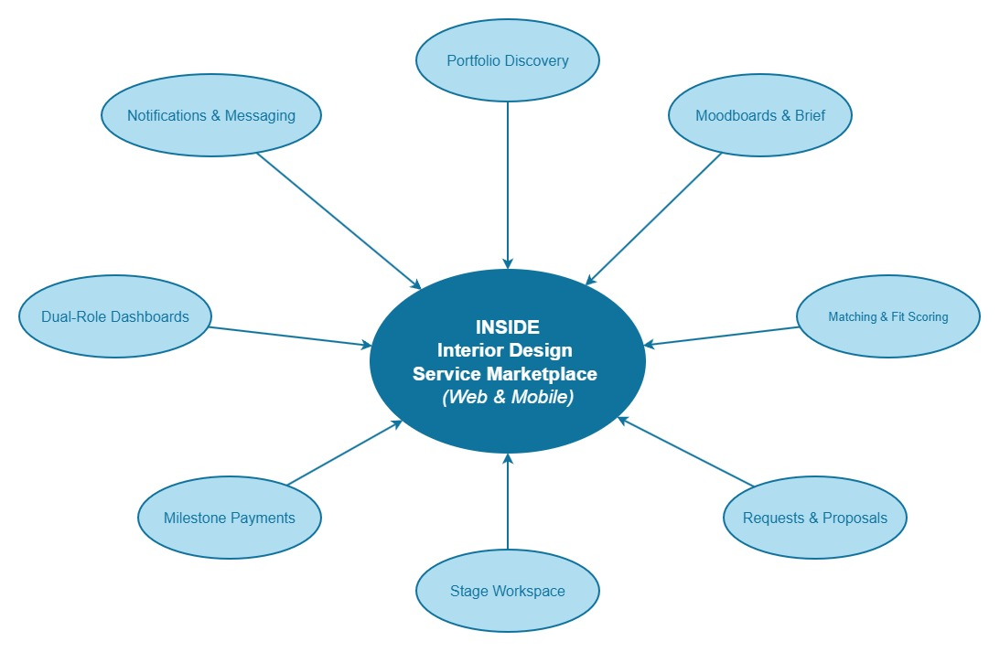
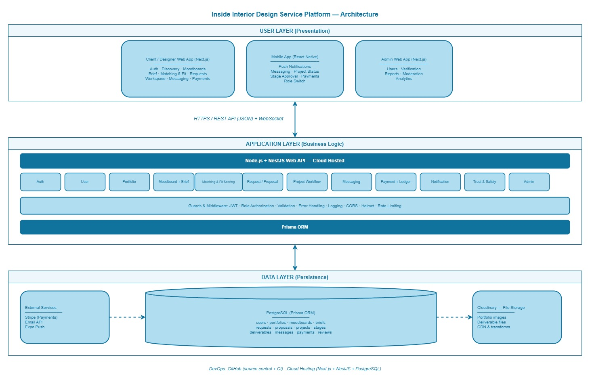
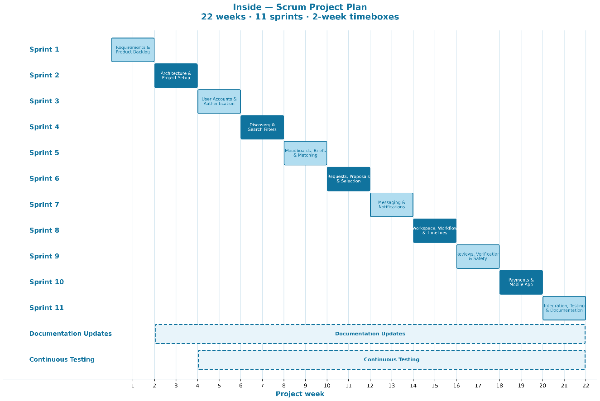

{width="2.6381944444444443in"
height="1.0416666666666667in"}{width="1.9263921697287838in"
height="1.0416666666666667in"}

Inside - Interior Design Service Marketplace

\[Final Project Proposal\]

# Project details

  -----------------------------------------------------------------------
  Title               Inside - Interior Design Service Marketplace
  ------------------- ---------------------------------------------------
  Student Name        M.N Sahla Baanu

  Registration No     00332652

  LMU ID              25045082

  Esoft ID            E301118

  Supervisor          

  Second Supervisor   

  Date Submitted      1^st^ June 2026

  Date Approved       
  -----------------------------------------------------------------------

# Table of Contents {#table-of-contents .TOC-Heading}

[Project details [2](#project-details)](#project-details)

[1. Introduction [3](#introduction)](#introduction)

[2. Background and Motivation
[3](#background-and-motivation)](#background-and-motivation)

[3. Problem in Brief [4](#problem-in-brief)](#problem-in-brief)

[4.Aim [5](#aim)](#aim)

[5. Objectives [5](#objectives)](#objectives)

[6. Proposed Solution [5](#proposed-solution)](#proposed-solution)

[Simple High Level Architecture Diagram
[7](#simple-high-level-architecture-diagram)](#simple-high-level-architecture-diagram)

[Detailed High Level Architecture Diagram
[7](#detailed-high-level-architecture-diagram)](#detailed-high-level-architecture-diagram)

[7. Resource Requirements
[7](#resource-requirements)](#resource-requirements)

[8. Deliverables [8](#deliverables)](#deliverables)

[9. Suggested Starting Point
[9](#suggested-starting-point)](#suggested-starting-point)

[10. Project Plan [9](#project-plan)](#project-plan)

[Gantt Chart [10](#gantt-chart)](#gantt-chart)

[11. References [10](#_Toc231245523)](#_Toc231245523)

# 1. Introduction

The interior design industry has increasingly adopted digital platforms
as clients and designers rely on online services to discover
opportunities, share ideas, and manage projects. However, the process of
finding designers, communicating requirements, tracking project
progress, and managing payments is often fragmented across multiple
platforms and communication channels, creating inefficiencies for both
clients and designers.

This fragmentation can lead to misunderstandings, repeated revisions,
delays, and reduced transparency throughout the project lifecycle.
Interior design projects are highly visual and often require continuous
collaboration, making it important to provide a structured environment
that supports communication, project management, and secure payment
handling within a single platform.

To address this problem, this project proposes the development of an
Interior Design Service Platform that connects clients and interior
designers through web and mobile applications. The proposed solution
integrates designer discovery, project collaboration, communication,
project tracking, and milestone-based payment management into one
system. The platform will be developed using Next.js, React Native,
Node.js/NestJS, PostgreSQL, Cloudinary, and Stripe to provide a secure,
scalable, and user-friendly environment for managing the complete
interior design service process.

# 2. Background and Motivation 

The interior design industry increasingly relies on digital platforms to
connect clients with professional designers. As demand for online design
services grows, designer discovery, communication, project management,
and payment handling have become more digital. However, many existing
platforms focus on only part of the process, creating a fragmented
experience for clients and designers.

Platforms such as Havenly, Decorilla, and Houzz support online interior
design and designer discovery, (Havenly, 2026), (Decorilla, 2026),
(Houzz, 2026), while Fiverr, Upwork, and Behance support freelance
hiring and portfolio showcasing (Fiverr , 2026), (Upwork, 2026),
(Behance, 2026). Despite these offerings, there is limited support for a
single platform that combines designer discovery, project collaboration,
and milestone-based payment management within one environment.

This problem is worth addressing because interior design projects depend
on clear communication between clients and designers. Poor communication
can lead to misunderstandings, repeated revisions, and project delays.
Research suggests that structured collaboration improves project
outcomes (Minois, 2025).while secure payment handling helps build trust
between service providers and clients (Stripe, 2026).

The motivation for undertaking this project comes from the opportunity
to apply software engineering principles to a real-world business
domain. My background in web development, database design, software
engineering, and API integration provides a strong foundation for
developing the proposed solution while gaining experience with modern
technologies and cloud services.

# 3. Problem in Brief

The main problem addressed by this project is the lack of a dedicated
platform that supports the complete interaction process between clients
and interior designers. Clients often rely on multiple platforms and
communication channels to discover design inspiration, find suitable
designers, discuss requirements, manage project progress, and handle
payments. This fragmented approach makes it difficult to maintain clear
communication, track project activities, and ensure that both parties
have a shared understanding of project expectations.

Interior design projects are highly visual and frequently involve
multiple revisions before reaching a final outcome. Clients may find it
difficult to communicate their preferences using text-based descriptions
alone, while designers may not receive sufficient information to
accurately understand client expectations. In addition, project
approvals and payment processes are often handled through separate
tools, creating inefficiencies and reducing transparency throughout the
project lifecycle. The absence of mechanisms that promote trust,
accountability, and effective issue resolution can further reduce user
confidence when engaging with unfamiliar service providers.

This problem is worth solving because ineffective communication, unclear
requirements, and disconnected workflows can lead to project delays,
repeated revisions, and reduced satisfaction for both clients and
designers. A dedicated platform that combines designer discovery,
project interaction, communication, and milestone-based payment
management within a single environment can improve transparency, support
better collaboration, and provide a more structured approach to managing
interior design projects.

# 4.Aim

The aim of this project is to design, develop, and evaluate an Interior
Design Service Platform that addresses the fragmented process of
designer discovery, project collaboration, and payment management by
providing an integrated environment for clients and interior designers
through web and mobile applications, using Next.js, React Native,
Node.js/NestJS, PostgreSQL and secure payment integration.

# 5. Objectives

-   Conduct a critical review of the interior design service domain and
    identify limitations in existing digital platforms used for designer
    discovery, project collaboration, and payment management.

-   Critically study technologies suitable for developing a modern web
    and mobile platform, including frontend, backend, database, cloud,
    and payment integration technologies.

-   Design and develop an Interior Design Service Platform that supports
    designer discovery, project collaboration, communication, trust and
    safety mechanisms, and secure payment management through web and
    mobile applications.

-   Evaluate the proposed system against functional and non-functional
    requirements through testing, user feedback, and performance
    assessment.

-   Prepare comprehensive project documentation, including technical
    documentation, user documentation, and the final dissertation
    report.

# 6. Proposed Solution

The proposed solution is an Interior Design Service Platform that
provides a centralized environment for clients, interior designers, and
administrators to discover, communicate, collaborate, and manage
interior design projects through web and mobile applications. The
platform aims to address the fragmented nature of current interior
design services by bringing designer discovery, project collaboration,
communication, project tracking, payment management, and trust and
safety features into a single system.

Unlike existing interior design services, portfolio platforms, or
general freelance marketplaces, the proposed platform combines
portfolio-based designer discovery, designer matching, project
collaboration, milestone-based payments, and platform governance within
one integrated environment. This allows clients to make informed hiring
decisions while providing designers with a structured way to manage
projects and client interactions.

The platform supports the complete interior design project lifecycle.
Clients can browse designer portfolios, create moodboards, generate
project briefs, search for suitable designers, submit project requests,
compare proposals, and manage active projects. Designers can showcase
their work, respond to project opportunities, submit deliverables, and
track project progress. Administrators oversee platform operations
through user management, verification, moderation, reporting, and
analytics.

The proposed system follows a three-tier architecture consisting of
presentation, application, and data layers. The presentation layer
includes the Next.js web application and React Native mobile
application. The application layer consists of a Node.js/NestJS API that
manages business logic and system operations. The data layer utilizes
PostgreSQL for data management, Cloudinary for media storage, and Stripe
for payment processing. High-level and detailed architecture diagrams
are provided to illustrate the overall system structure.

The architecture promotes scalability, maintainability, and security by
separating the user interface, business logic, and data management
components. This approach provides a reliable foundation for supporting
the complete interior design service process and future platform growth.

## Simple High Level Architecture Diagram 

{width="4.88184820647419in"
height="3.184524278215223in"}

## Detailed High Level Architecture Diagram 

{width="6.018055555555556in"
height="3.876388888888889in"}

# 7. Resource Requirements

Hardware

-   Laptop/PC (8 GB RAM minimum, 16 GB recommended)

-   Stable internet connection

-   Mobile device or emulator for testing

  -----------------------------------------------------------------------
  Category                   Software Technology
  -------------------------- --------------------------------------------
  Frontend                   Next.js, React Native, TypeScript

  Backend                    Node.js, NestJS

  Database                   PostgreSQL, Prisma

  Storage                    Cloudinary

  Payments                   Stripe

  Development Tools          VS Code, Git, GitHub

  Testing Tools              Postman, Swagger

  Design Tools               Figma, draw.io
  -----------------------------------------------------------------------

Other Requirements

-   Cloud hosting

-   Database backup

-   Email service

-   Push notification service

-   Volunteer users for testing

Estimated Cost

Most tools and services provide free-tier plans suitable for development
and testing. Additional costs may include cloud hosting and domain
registration.

# 8. Deliverables

> Working System

-   Web-based Interior Design Service Platform

-   Mobile Application

-   NestJS REST API

-   PostgreSQL Database System

> Documentation

-   Technical Documentation

-   User Manual

> Additional Deliverables

-   Architecture Diagrams

-   Database Design

-   Test and Evaluation Report

# 9. Suggested Starting Point

-   Identify stakeholder needs and gather system requirements.

-   Review existing interior design platforms and related literature to
    understand the problem domain and identify gaps.

-   Create and prioritize the product backlog based on project
    objectives and user requirements.

-   Design the initial system architecture, database structure, and user
    interface wireframes.

-   Set up the development environment and required technologies to
    begin iterative development.

# 10. Project Plan

-   Development Methodology: Agile (Scrum Framework)

-   Project Duration: Approximately 22 Weeks

-   Sprint Duration: 2 Weeks

## Gantt Chart

{width="6.018055555555556in"
height="4.024305555555555in"}

# 11. References

Behance, 2026. *Behance.* \[Online\]\
Available at: [https://www.behance.net/]{.underline}\
\[Accessed 10 May 2026\].

Decorilla, 2026. *Decorilla.* \[Online\]\
Available at: [https://www.decorilla.com/]{.underline}\
\[Accessed 10 May 2026\].

Fiverr , 2026. *Fiverr.* \[Online\]\
Available at: [https://www.fiverr.com/]{.underline}\
\[Accessed 10 May 2026\].

Havenly, 2026. *Havenly.* \[Online\]\
Available at: [https://havenly.com/]{.underline}\
\[Accessed 10 May 2026\].

Houzz, 2026. *Houzz.* \[Online\]\
Available at: [https://www.houzz.com/]{.underline}\
\[Accessed 10 May 2026\].

Minois, N., 2025. *The Importance of Communication in Project
Management.* \[Online\]\
Available at:
[https://instituteprojectmanagement.com/fr/blog/the-crucial-role-of-communication-in-project-management/]{.underline}\
\[Accessed 20 May 2026\].

Stripe, 2026. *Stripe.* \[Online\]\
Available at: [https://stripe.com/]{.underline}\
\[Accessed 20 May 2026\].

Upwork, 2026. *Upwork.* \[Online\]\
Available at: [https://www.upwork.com/]{.underline}\
\[Accessed 10 May 2026\].
