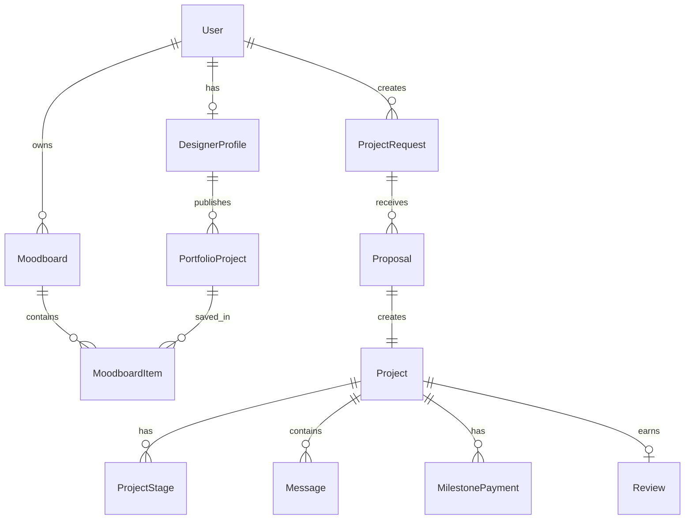

# Diagrams & Gantt Chart — Instructions

> System flows: [SYSTEM-OVERVIEW.md](../SYSTEM-OVERVIEW.md)

Aligned with lecturer template ([Sample/sample.md](Sample/sample.md)):

- **Architecture diagrams** → end of [06-proposed-solution.md](06-proposed-solution.md) (Figures 1–2)
- **Gantt chart** → [10-project-plan.md](10-project-plan.md) (Figure 3)

Create all visual assets and store them in:

```
docs/Proposal/diagrams/
├── 01-context-diagram.png
├── 02-simple-architecture.png
├── 03-detailed-architecture.png
├── 04-use-case-diagram.png
├── 05-er-diagram.png
├── 06-project-workflow.png
├── 07-gantt-chart.png
└── wireframes/          (optional)
```

Reference the lecturer’s samples in [Sample/](Sample/) for layout style.

---

## Tool Recommendations

| Tool | Best for | Cost |
|------|----------|------|
| [draw.io / diagrams.net](https://app.diagrams.net) | Architecture, ER, use case, workflow | Free |
| [Lucidchart](https://www.lucidchart.com) | Professional diagrams | Free tier |
| [Figma](https://figma.com) | Wireframes, UI mockups | Free tier |
| [Mermaid Live Editor](https://mermaid.live) | Quick drafts from code | Free |
| Microsoft Excel / Google Sheets | Gantt chart | Free |
| [PlantUML](https://plantuml.com) | ER / sequence (text-based) | Free |

**Export settings:** PNG, 300 DPI minimum for print; white background; black/grey lines (lecturer samples are monochrome).

---

## Diagram 1 — Context Diagram

**Purpose:** Show Inside as one system and external actors/systems around it.

**Include:**

- **Actors:** Client, Designer, System Administrator (optional)
- **External systems:** Stripe, AWS S3, AWS SES, Amazon RDS PostgreSQL, Cognito
- **Central box:** Inside Platform

**Layout:**

```
        [Client] ----\
                      ---> [ Inside Platform ] ---> [ Amazon RDS ]
        [Designer] ---/              |
                                     +---> [ AWS S3 ]
                                     +---> [ Stripe ]
                                     +---> [ AWS SES ]
```

**Steps (draw.io):**

1. New diagram → Basic shapes.
2. Place rounded rectangle in centre: `Inside Platform`.
3. Add stick figures or rectangles for Client and Designer on the left.
4. Add cylinders/clouds for external services on the right.
5. Label arrows with data flow, e.g. `browse portfolios`, `pay milestone`, `upload deliverables`.
6. Export as `01-context-diagram.png`.

**Insert in proposal:** [supporting/system-design.md](supporting/system-design.md) (optional for dissertation).

---

## Diagrams 2 & 3 — Architecture (Simple + Detailed)

**Full source (Mermaid, ASCII, module tables, sequence diagram, export steps):**

👉 **[diagrams/architecture-diagrams.md](diagrams/architecture-diagrams.md)**

| Figure | File | Description |
|--------|------|-------------|
| 1 | `02-simple-architecture.png` | Three-tier: Presentation → Application → Data |
| 2 | `03-detailed-architecture.png` | All UI modules + API services + AWS/external services |

**Quick export:** Copy Mermaid from `architecture-diagrams.md` → [mermaid.live](https://mermaid.live) → Export PNG.

**Lecturer layout reference:** [Sample/simple high level architecture diagram .png](Sample/simple%20high%20level%20architecture%20diagram%20.png) and [detailed diagram](Sample/detailed%20high%20level%20architecture%20diagram%20.png).

**Insert in:** [06-proposed-solution.md](06-proposed-solution.md) — Figures 1 and 2.

---

## Diagram 4 — Use Case Diagram

**Purpose:** Show who can do what.

**Actors:** Client, Designer, Guest (unauthenticated visitor)

**Client use cases:** Browse feed, Create moodboard, Post project request, Accept proposal, Approve milestone, Send message, Leave review

**Designer use cases:** Publish portfolio, Submit proposal, Upload deliverable, Update availability, Receive payout (via Stripe)

**Guest use cases:** Browse public feed (read-only)

**Tool:** draw.io → UML → Use Case diagram template.

**Export:** `04-use-case-diagram.png` → insert in [supporting/system-design.md](supporting/system-design.md).

---

## Diagram 5 — Entity Relationship (ER) Diagram

**Purpose:** Database design for proposal and implementation.

**Core entities:**

- User, DesignerProfile, PortfolioProject, Moodboard, MoodboardItem
- ProjectRequest, Proposal, Project, ProjectStage, Deliverable
- Message, MilestonePayment, Review, Notification

**Key relationships:**

- User 1—1 DesignerProfile (optional)
- User 1—* Moodboard
- DesignerProfile 1—* PortfolioProject
- Moodboard *—* PortfolioProject (via MoodboardItem)
- ProjectRequest 1—* Proposal
- Proposal 1—1 Project
- Project 1—* ProjectStage, Message, MilestonePayment
- Project 1—1 Review

**Mermaid starter** (paste into mermaid.live, export PNG):



**Export:** `05-er-diagram.png`.

---

## Diagram 6 — Project Workflow / Stage State Machine

**Purpose:** Show interior design stages and payment gates.

**Stages (left to right):**

`Proposal → Concept → Design → Revision → Completion`

**Rules to label on diagram:**

- Designer uploads deliverable at each stage
- Client must approve before stage advances
- Milestone payment released on approval (3 payment points)
- Review only after Completion

**Export:** `06-project-workflow.png` → [supporting/system-design.md](supporting/system-design.md) (optional).

---

## Diagram 7 — Gantt Chart

**Purpose:** Project plan timeline for [10-project-plan.md](10-project-plan.md) — **required in proposal**.

**Match style of:** [Sample/Gantt Chart.png](Sample/Gantt%20Chart.png)

### Option A — Microsoft Excel / Google Sheets

1. Column A: Task name (see task list below).
2. Column B: Start week (1–13).
3. Column C: Duration in weeks.
4. Select data → Insert → Bar chart → Stacked bar → format as Gantt (hide start series or use start date + duration).
5. Colour bars by phase: Research (blue), Design (green), Dev (orange), Test (red), Docs (grey).
6. Export as `07-gantt-chart.png`.

### Option B — draw.io

1. Use “Gantt” template or draw horizontal bars on a week grid (Week 1–13).
2. One row per task; bar length = duration.

### Task list (13 weeks)

| Task | Start | Weeks |
|------|-------|-------|
| Research & requirements | 1 | 2 |
| System design & wireframes | 3 | 1 |
| Database & API design | 4 | 1 |
| AWS setup & CI/CD | 4 | 1 |
| Auth + dual-role | 5 | 1 |
| Portfolio + discovery feed | 6 | 2 |
| Moodboards + project requests | 7 | 1 |
| Proposals + project creation | 8 | 1 |
| Project workspace + messaging | 9 | 2 |
| Stripe milestones + S3 uploads | 10 | 2 |
| Reviews + notifications | 11 | 1 |
| Testing & bug fixes | 12 | 1 |
| Evaluation + documentation | 13 | 1 |

---

## Optional — Wireframes (UI)

Create 5–6 low-fidelity screens in Figma:

1. Discovery feed (grid of portfolio cards + filters)
2. Moodboard page
3. Project request form (with moodboard attach)
4. Designer dashboard (proposals inbox)
5. Project workspace (stage timeline + chat + files)
6. Milestone payment approval modal

Store in `diagrams/wireframes/` and reference in [supporting/system-design.md](supporting/system-design.md).

---

## Checklist Before Submission

- [ ] All diagrams referenced in markdown use correct relative path
- [ ] Diagrams are readable when printed A4
- [ ] Figure captions added in Word, e.g. *Figure 1: Simple three-tier architecture of Inside*
- [ ] Gantt weeks match [10-project-plan.md](10-project-plan.md) table
- [ ] Architecture diagrams match technology listed in [07-resource-requirements.md](07-resource-requirements.md)
