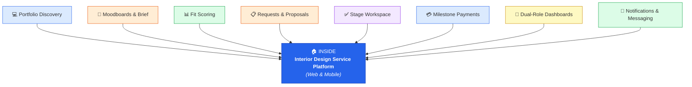
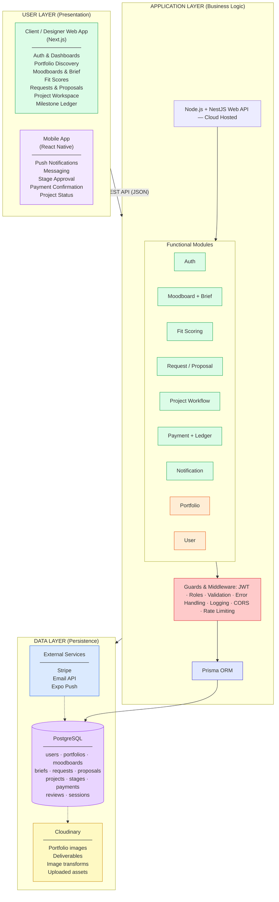
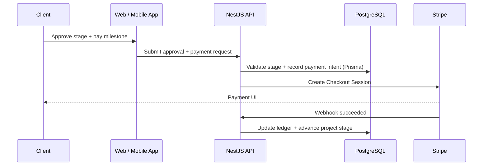

# Architecture Diagrams

**Project:** Inside — Interior Design Service Platform  
**Stack:** Next.js + React Native + **Node.js / NestJS** + **PostgreSQL (Prisma)** + **Cloudinary** + **Stripe** + Cloud Hosting + GitHub

Match the **lecturer sample layout** ([Sample/](../Sample/)): Figure 1 = feature hub; Figure 2 = detailed three-tier.

| Figure | Style (sample equivalent) | Export file | Source |
|--------|---------------------------|-------------|--------|
| 1 — System features hub | AHC TOURS hub-and-spoke | `01-feature-overview.png` | [Simple AD.drawio](Simple%20AD.drawio) |
| 2 — Detailed architecture | Three-tier with modules | `02-detailed-architecture.png` | [Detailed AD.drawio](Detailed%20AD.drawio) |

**Export:** Open the `.drawio` files in [draw.io](https://app.diagrams.net) or Canva (import PNG guide) → Export PNG (white background, 300 DPI). Or use Mermaid blocks below via [mermaid.live](https://mermaid.live).

---

## Figure 1 — System Features Overview (Hub-and-Spoke)

Central hub: **INSIDE — Interior Design Service Platform (Web & Mobile)**  
Eight feature nodes with coloured arrows pointing **inward** to the centre (same layout as sample).

| Position | Feature node | Colour (sample match) |
|----------|--------------|------------------------|
| 12 o'clock | Portfolio Discovery | Blue |
| 1:30 | Moodboards & Brief | Orange |
| 3 o'clock | Fit Scoring | Green |
| 4:30 | Requests & Proposals | Orange |
| 6 o'clock | Stage Workspace | Purple |
| 7:30 | Milestone Payments | Blue |
| 9 o'clock | Dual-Role Dashboards | Yellow |
| 10:30 | Notifications & Messaging | Green |

### Mermaid (export fallback)



---

## Figure 2 — Detailed High-Level Architecture (Three-Tier)

Title: **Inside Interior Design Service Platform — Architecture**

### 1. USER LAYER (Presentation)

Communication to application tier: **HTTPS / REST API (JSON)**

| Client | Technology | Key features |
|--------|------------|--------------|
| **Client / Designer Web App** | Next.js (TypeScript, Tailwind) | Auth & dashboards · Portfolio discovery · Moodboards & brief · Fit scores · Requests & proposals · Project workspace · Milestone ledger · Multi-role switch |
| **Mobile App** | React Native — iOS / Android | Push notifications · Messaging · Stage approval · Payment confirmation · Project status · Multi-role switch |

### 2. APPLICATION LAYER (Business Logic)

**Node.js + NestJS Web API** (cloud-hosted)

| Module | Colour group | Responsibility |
|--------|--------------|----------------|
| Auth Module | Green | JWT, Passport, dual-role (client/designer) |
| Moodboard + Brief Module | Green | Saved projects, structured brief generation |
| Fit Scoring Module | Green | Designer ranking, score breakdown |
| Request / Proposal Module | Green | Requests, proposals, comparison |
| Project Workflow Module | Green | Stages, deliverables, version history, approval |
| Payment + Ledger Module | Green | Stripe milestones, payment audit trail |
| Notification Module | Green | In-app, push, email alerts |
| Portfolio Module | Orange | Case studies, discovery filters |
| User Module | Orange | Profiles, availability, reviews |

**Middleware / guards layer** (red box, spans all requests):

- JWT Authentication · Role Authorization · Input Validation (class-validator) · Error Handling · Logging  
- Security / performance: CORS, Helmet, Rate Limiting

**Data access:** Prisma ORM → PostgreSQL

### 3. DATA LAYER (Persistence)

| Component | Contents |
|-----------|----------|
| **PostgreSQL** (centre, via **Prisma ORM**) | users, designer_profiles, portfolio_projects, moodboards, structured_briefs, project_requests, proposals, projects, project_stages, deliverables, milestone_payments, reviews, sessions |
| **External Services** (left, dotted line) | **Stripe** — payment gateway · **Email API** — transactional email · **Expo Push** — mobile notifications |
| **Cloudinary** (right, dotted line) | Portfolio images · Deliverable files · Image transforms & CDN · Uploaded assets |

**DevOps:** GitHub (source control + CI) · Cloud hosting (Next.js + NestJS + PostgreSQL)

### Mermaid (export fallback)



### ASCII layout (sample-style)

```
┌──────────────────────── USER LAYER ────────────────────────────┐
│  [ Client/Designer Web App — Next.js ]  [ Mobile — React Native ]│
└────────────────────────────┬───────────────────────────────────┘
                             │ HTTPS / REST API
┌──────────────────────── APPLICATION LAYER ─────────────────────┐
│  Node.js + NestJS Web API                                          │
│  [Auth][Brief][Fit][Request][Workflow][Payment][Notify]            │
│  [Portfolio][User]                                                 │
│  [ Guards: JWT · Roles · Validation · Logging · CORS ]             │
│  [ Prisma ORM ]                                                    │
└──────────────┬─────────────────────┬───────────────────────────┘
               │                     │
┌──────────────▼──────┐    ┌─────────▼─────────┐    ┌─────────────┐
│ External Services   │    │ PostgreSQL        │    │ Cloudinary  │
│ Stripe · Email ·    │◄──►│ users, projects,  │◄──►│ images,     │
│ Expo Push           │    │ payments, …       │    │ deliverables│
└─────────────────────┘    └───────────────────┘    └─────────────┘
        GitHub (CI) · Cloud Hosting
```

---

## Payment approval sequence



---

## Solution structure (NestJS monorepo)

```
api/                  # NestJS — controllers, modules, guards
├── src/modules/      # auth, portfolio, moodboard, fit-scoring, …
prisma/               # schema.prisma, migrations
web/                  # Next.js web client
mobile/               # React Native app
.github/              # GitHub Actions CI
```

---

## Export checklist

- [ ] `01-feature-overview.png` — hub centred, 8 nodes readable at A4 width
- [ ] `02-detailed-architecture.png` — all three tiers and module boxes legible
- [ ] `07-gantt-chart.png` — readable at A4 width
- [ ] Technology matches [07-resource-requirements.md](../07-resource-requirements.md)
