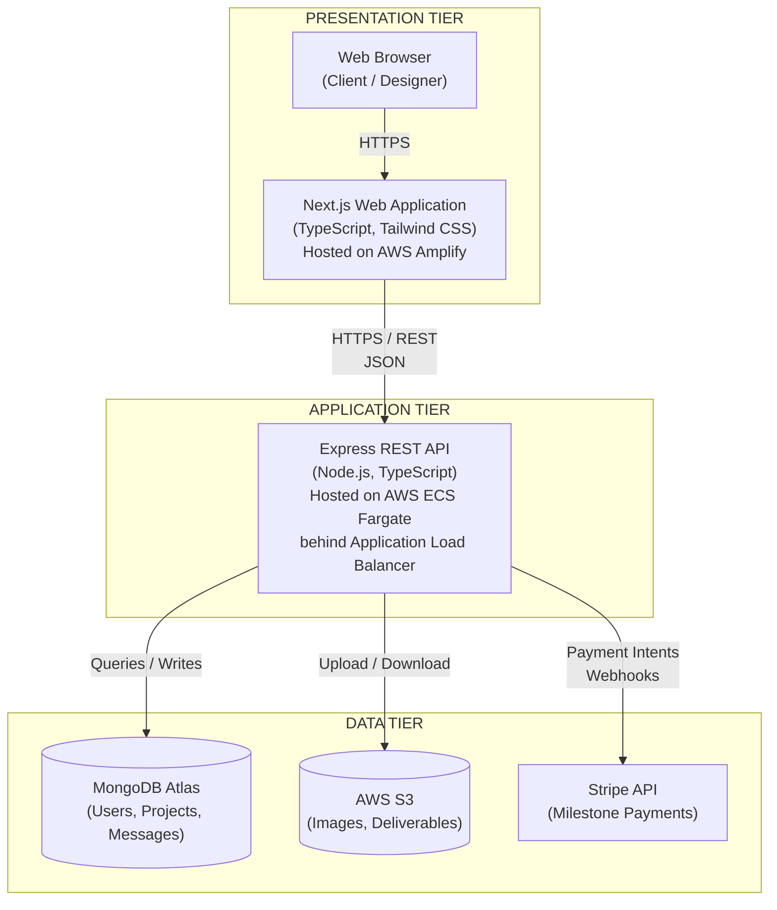
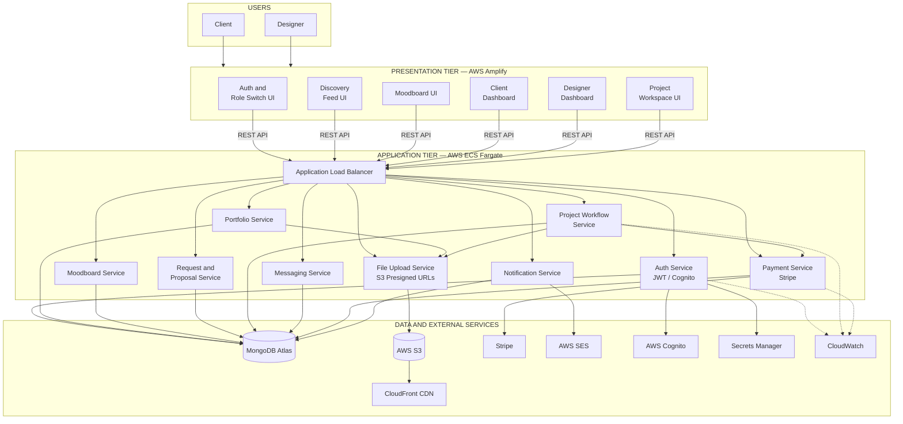
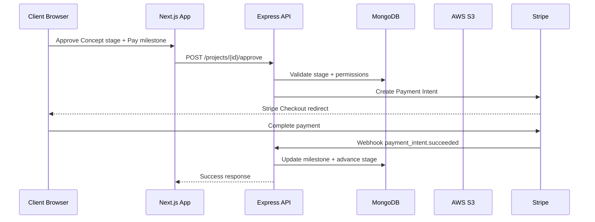
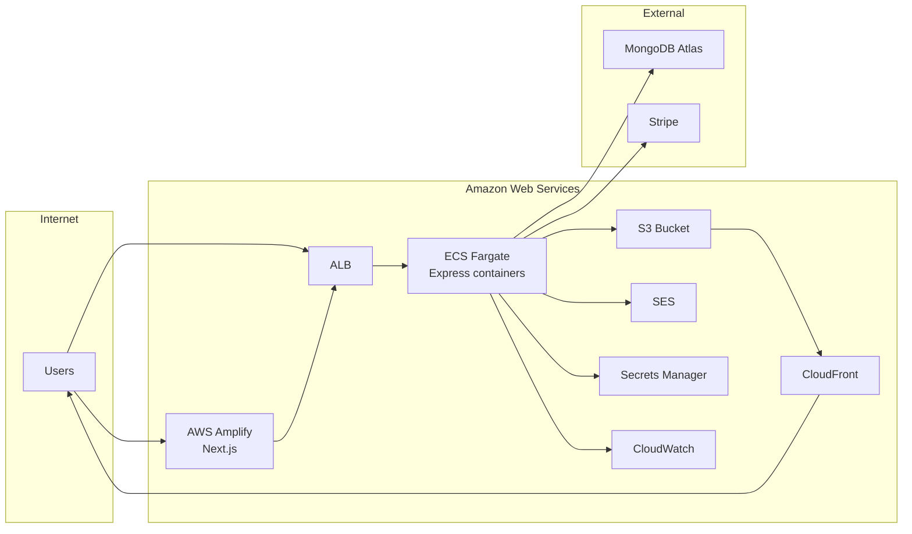

# Inside — Architecture Diagrams

Ready-to-use **simple** and **detailed** high-level architecture diagrams for the proposal ([06-proposed-solution.md](../06-proposed-solution.md)).

| Figure | Diagram | Export file |
|--------|---------|-------------|
| 1 | Simple three-tier | `02-simple-architecture.png` |
| 2 | Detailed module architecture | `03-detailed-architecture.png` |

**Export:** Copy each Mermaid block into [mermaid.live](https://mermaid.live) → Export PNG → save to this folder.  
**Style:** White background, black/grey lines (match [Sample/simple high level architecture diagram .png](../Sample/simple%20high%20level%20architecture%20diagram%20.png)).

---

## Figure 1 — Simple High-Level Architecture (Three-Tier)

### Purpose

Shows how the system is split into **Presentation**, **Application**, and **Data** tiers — the minimum architecture view required in the proposal.

### Diagram (Mermaid)



### ASCII layout (for Word if Mermaid unavailable)

```
┌─────────────────────────────────────────────────────────────┐
│                    PRESENTATION TIER                         │
│  [ Web Browser ]  ──HTTPS──►  [ Next.js on AWS Amplify ]    │
└──────────────────────────────┬──────────────────────────────┘
                               │ HTTPS / REST (JSON)
┌──────────────────────────────▼──────────────────────────────┐
│                    APPLICATION TIER                          │
│         [ Express REST API on AWS ECS Fargate + ALB ]        │
└───────┬─────────────────────┬─────────────────────┬─────────┘
        │                     │                     │
┌───────▼────────┐   ┌────────▼────────┐   ┌───────▼────────┐
│  DATA TIER     │   │  DATA TIER      │   │  DATA TIER     │
│ MongoDB Atlas  │   │   AWS S3        │   │  Stripe API    │
└────────────────┘   └─────────────────┘   └────────────────┘
```

### Tier summary

| Tier | Component | Technology | Responsibility |
|------|-----------|------------|----------------|
| Presentation | Web Browser | Chrome, Edge, Safari | User interface access |
| Presentation | Next.js App | Next.js 14, AWS Amplify | Pages, dashboards, discovery feed, forms |
| Application | Express API | Node.js, ECS Fargate, ALB | Business logic, auth, workflow, validation |
| Data | MongoDB Atlas | MongoDB | Persistent application data |
| Data | AWS S3 | S3 + CloudFront | Portfolio images, project deliverables |
| Data | Stripe | Stripe API | Milestone payment processing |

### Data flows

| # | Flow | Protocol |
|---|------|----------|
| 1 | Browser loads web app | HTTPS |
| 2 | Next.js calls API for data/actions | HTTPS REST |
| 3 | API reads/writes business data | MongoDB driver |
| 4 | API stores/retrieves files | S3 SDK (presigned URLs) |
| 5 | API creates payments, receives webhooks | Stripe HTTPS |

---

## Figure 2 — Detailed High-Level Architecture

### Purpose

Expands each tier into **modules** (UI screens and API services), matching the lecturer’s detailed bus-reservation example style.

### Diagram (Mermaid)



### Module reference

#### Presentation tier (Next.js)

| Module | Users | Main functions |
|--------|-------|----------------|
| Auth and Role Switch UI | All | Login, register, switch client/designer dashboard |
| Discovery Feed UI | Client, Guest | Browse/filter portfolio projects |
| Moodboard UI | Client | Create boards, save projects, attach to requests |
| Client Dashboard | Client | Requests, proposals, active projects |
| Designer Dashboard | Designer | Portfolio, proposals inbox, availability |
| Project Workspace UI | Client, Designer | Stages, chat, deliverables, milestone approval |

#### Application tier (Express services)

| Service | Connects to | Responsibility |
|---------|-------------|----------------|
| Auth Service | MongoDB, Cognito, Secrets Manager | Login, JWT, dual-role permissions |
| Portfolio Service | MongoDB, File Upload | Designer case studies, discovery feed data |
| Moodboard Service | MongoDB | Boards and saved portfolio items |
| Request and Proposal Service | MongoDB | Hiring marketplace, accept proposal |
| Project Workflow Service | MongoDB, Payment, File Upload | Stage transitions, approvals |
| Messaging Service | MongoDB | Project-scoped chat |
| Payment Service | Stripe, MongoDB | Milestone checkout, webhooks |
| Notification Service | MongoDB, SES | In-app and email alerts |
| File Upload Service | S3 | Presigned upload/download URLs |

#### Data and external services

| Service | Stores / provides |
|---------|-------------------|
| MongoDB Atlas | Users, profiles, portfolios, moodboards, requests, proposals, projects, messages, payments, reviews |
| AWS S3 | Image and document binaries |
| CloudFront | Fast public delivery of portfolio images |
| Stripe | Card payments, payment status webhooks |
| AWS SES | Email notifications |
| AWS Cognito | User pool (optional alongside JWT) |
| Secrets Manager | API keys, DB connection strings |
| CloudWatch | API logs, errors, basic metrics |

### Key internal flows (detailed)



---

## Deployment view (AWS)



---

## How to export for the proposal

### Option A — Mermaid Live (fastest)

1. Open https://mermaid.live
2. Paste the **Figure 1** Mermaid block → **Export PNG** → save as `02-simple-architecture.png`
3. Paste the **Figure 2** Mermaid block → adjust zoom until readable → **Export PNG** → save as `03-detailed-architecture.png`
4. Images are already linked from [06-proposed-solution.md](../06-proposed-solution.md)

### Option B — draw.io (closest to lecturer samples)

1. Open https://app.diagrams.net
2. Recreate tiers as horizontal bands (Presentation / Application / Data)
3. Use **Figure 1** and **Figure 2** tables above for labels
4. Export PNG 300 DPI, white background

### Option C — VS Code / Cursor

Install **Markdown Preview Mermaid Support** → preview this file → screenshot crops (lower quality; prefer Option A).

---

## Checklist

- [ ] `02-simple-architecture.png` exported and readable at A4 width
- [ ] `03-detailed-architecture.png` exported — all module boxes legible
- [ ] Figure captions in Word: *Figure 1: Simple three-tier architecture* / *Figure 2: Detailed high-level architecture*
- [ ] Technology names match [07-resource-requirements.md](../07-resource-requirements.md)
