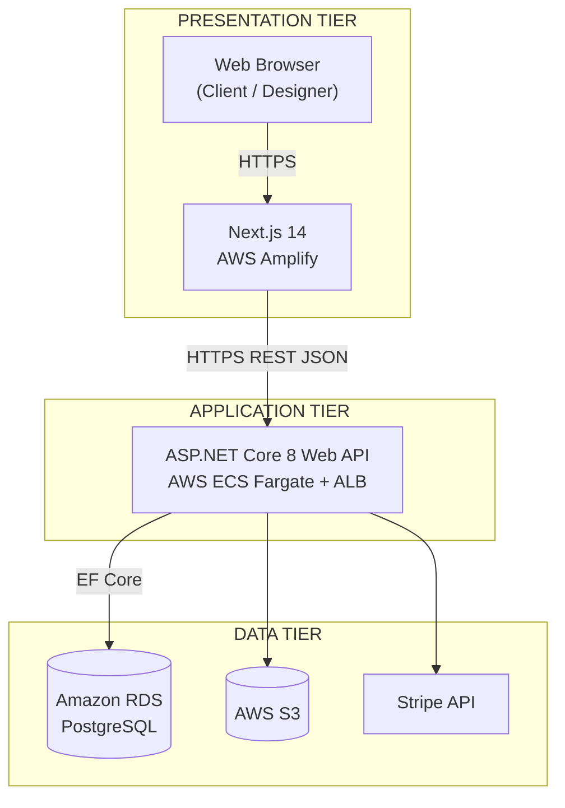
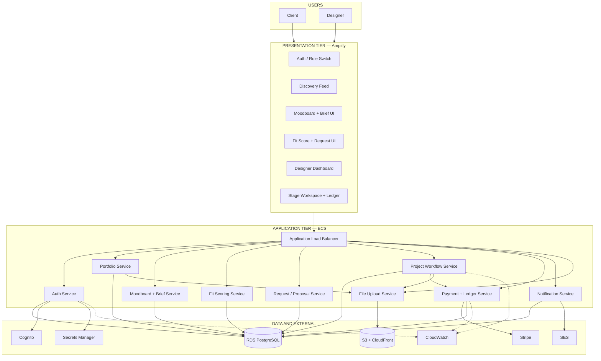
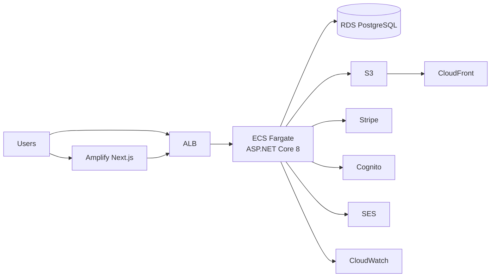
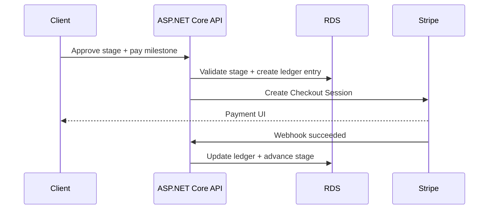

# Inside — Architecture Diagrams

**Stack:** Next.js (Amplify) + **ASP.NET Core 8 Web API** (ECS Fargate) + **Amazon RDS PostgreSQL** + AWS services.

| Figure | Export file |
|--------|-------------|
| 1 — Simple three-tier | `02-simple-architecture.png` |
| 2 — Detailed modules | `03-detailed-architecture.png` |

Export via [mermaid.live](https://mermaid.live) → PNG (white background).

---

## Figure 1 — Simple High-Level Architecture



### ASCII layout

```
[ Browser ] ──► [ Next.js / Amplify ]
                      │
                      ▼
              [ ASP.NET Core 8 API / ECS + ALB ]
                 │         │         │
                 ▼         ▼         ▼
            [ RDS PG ]  [ S3 ]  [ Stripe ]
```

### Tier summary

| Tier | Technology | Responsibility |
|------|------------|----------------|
| Presentation | Next.js 14, Amplify | UI, brief display, fit scores, stage workspace |
| Application | ASP.NET Core 8, ECS | Brief engine, fit scoring, workflow, Stripe webhooks |
| Data | RDS PostgreSQL | Users, projects, stages, ledger |
| Data | S3 + CloudFront | Portfolio and deliverable media |
| Data | Stripe | Milestone payments |

---

## Figure 2 — Detailed High-Level Architecture



### Application services

| Service | Responsibility |
|---------|----------------|
| Auth Service | Cognito integration, JWT, dual-role claims |
| Portfolio Service | Case studies, discovery queries |
| Moodboard + Brief Service | Boards, items, **structured brief generation** |
| Fit Scoring Service | Moodboard ↔ portfolio **compatibility %** |
| Request / Proposal Service | Hiring marketplace |
| Project Workflow Service | Stage transitions, deliverable approval |
| Payment + Ledger Service | Stripe, milestone audit trail |
| Notification Service | In-app + SES |
| File Upload Service | S3 presigned URLs |

---

## Deployment view (AWS)



---

## Payment approval sequence



---

## Solution structure (.NET)

```
src/
├── Inside.Api/              # Controllers, middleware
├── Inside.Application/      # BriefService, FitScoringService
├── Inside.Domain/           # Entities, ProjectStage enum
└── Inside.Infrastructure/   # EF Core, S3, Stripe, Cognito
web/                         # Next.js client
```

---

## Export checklist

- [ ] `02-simple-architecture.png` — readable at A4 width
- [ ] `03-detailed-architecture.png` — all service boxes legible
- [ ] Technology matches [07-resource-requirements.md](../07-resource-requirements.md)
