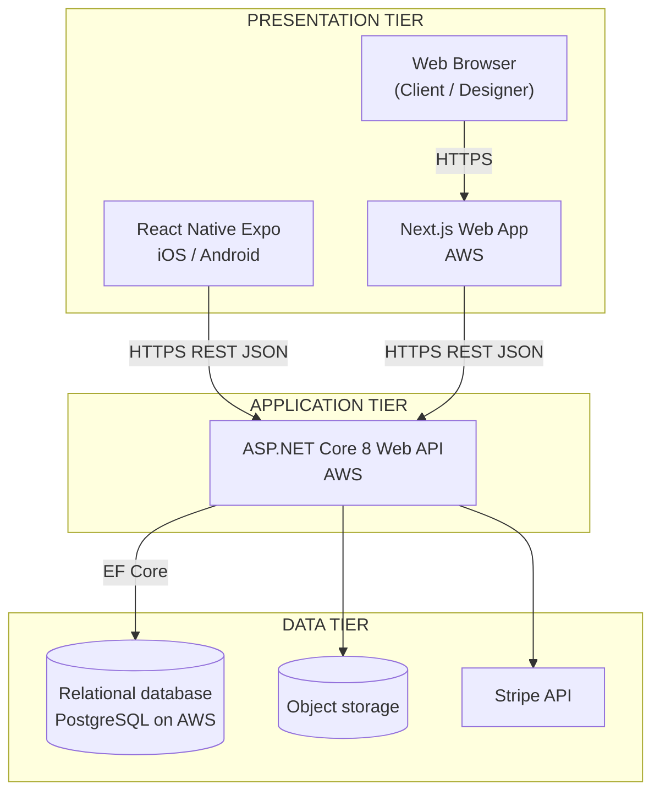
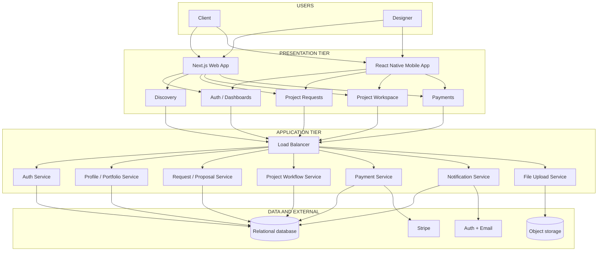
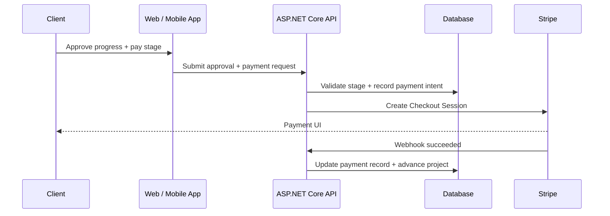

# Architecture Diagrams

**Stack:** Next.js + **React Native (Expo)** + **ASP.NET Core 8 Web API** + relational database on **AWS** + **Stripe**.

| Figure | Export file |
|--------|-------------|
| 1 — Simple three-tier | `02-simple-architecture.png` |
| 2 — Detailed modules | `03-detailed-architecture.png` |

Export via [mermaid.live](https://mermaid.live) → PNG (white background).

---

## Figure 1 — Simple High-Level Architecture



### ASCII layout

```
[ Browser ] ──► [ Next.js Web App ]
                      │
[ Mobile App ] ───────┼──► [ ASP.NET Core 8 Web API ]
                      │
                 │         │         │
                 ▼         ▼         ▼
         [ Database ]  [ Storage ]  [ Stripe ]
```

### Tier summary

| Tier | Technology | Responsibility |
|------|------------|----------------|
| Presentation | Next.js | Web UI — discovery, dashboards, detailed project workspace |
| Presentation | React Native (Expo) | Mobile UI — notifications, messaging, progress, approvals on the go |
| Application | ASP.NET Core 8 | Auth, workflow, payments, notifications (shared API) |
| Data | Relational DB on AWS | Users, projects, stages, payment records |
| Data | Object storage | Portfolio images and deliverables |
| Data | Stripe | Secure online payments |

---

## Figure 2 — Detailed High-Level Architecture



### Application services

| Service | Responsibility |
|---------|----------------|
| Auth Service | Registration, login, role-based access |
| Profile / Portfolio Service | Published work, discovery queries |
| Request / Proposal Service | Project needs, designer responses, client selection |
| Project Workflow Service | Staged delivery, feedback, approval of progress |
| Payment Service | Stripe integration, payment records per project |
| Notification Service | In-app alerts and email where required |
| File Upload Service | Media upload for portfolios and deliverables |

---

## Payment approval sequence



---

## Solution structure (.NET)

```
src/
├── Api/              # Controllers, middleware
├── Application/      # Business services
├── Domain/           # Entities, enums
└── Infrastructure/   # EF Core, storage, Stripe, auth
web/                  # Next.js web client
mobile/               # React Native (Expo) app
```

---

## Export checklist

- [ ] `02-simple-architecture.png` — readable at A4 width
- [ ] `03-detailed-architecture.png` — all service boxes legible
- [ ] Technology matches [07-resource-requirements.md](../07-resource-requirements.md)
