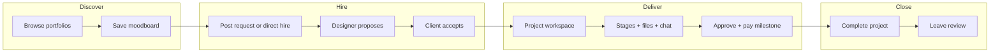
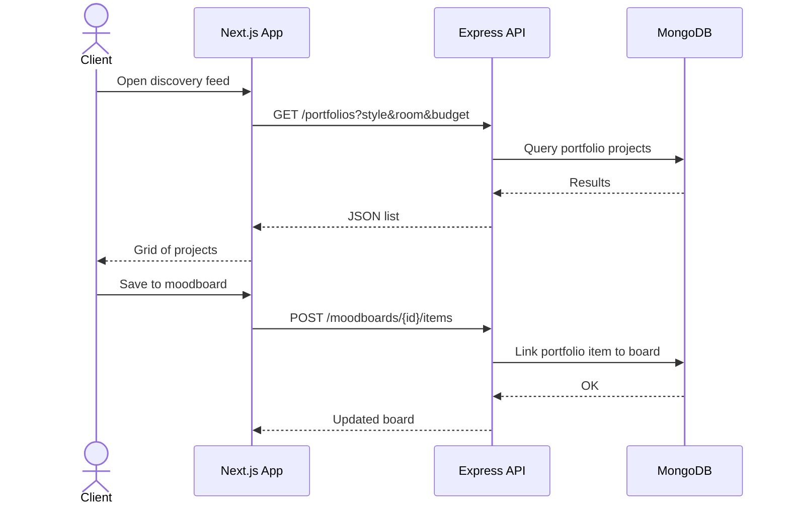
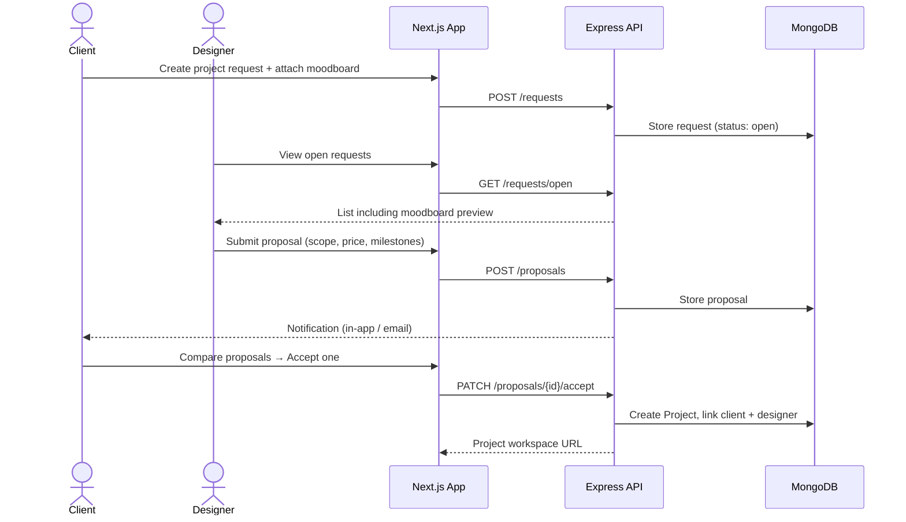
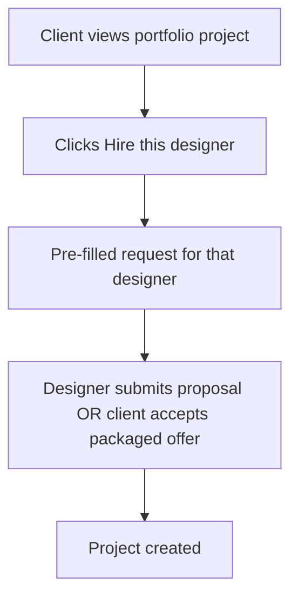
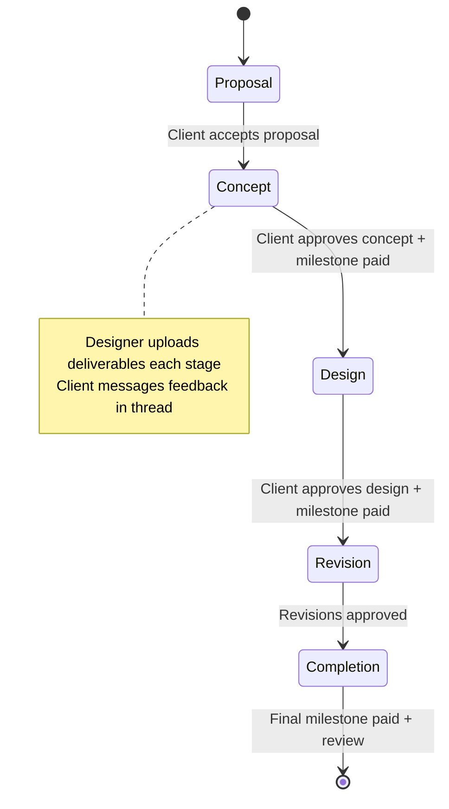
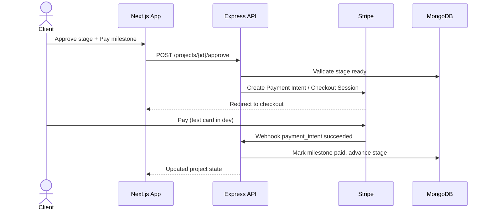
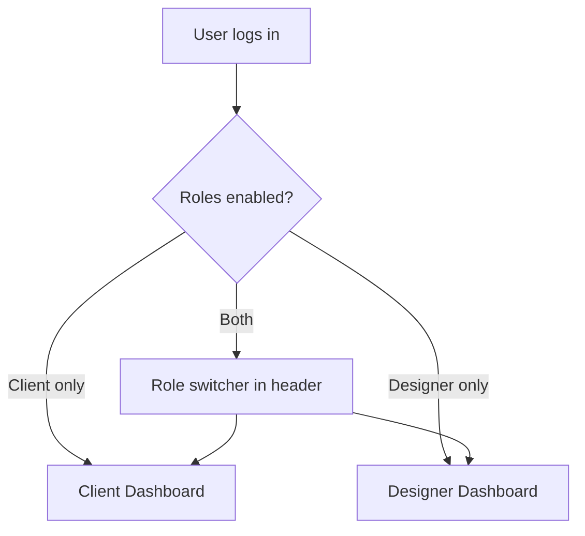
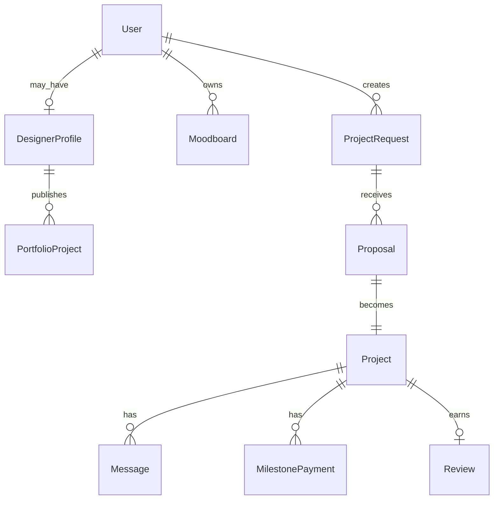

# Inside — System Overview

A clear guide to **what Inside is**, **who uses it**, and **how everything flows** from discovery to payment and review.

| For | Document |
|-----|----------|
| Proposal submission (ELMS) | [Proposal/README.md](Proposal/README.md) — sections `00`–`12` |
| Architecture diagrams | [Proposal/diagrams/architecture-diagrams.md](Proposal/diagrams/architecture-diagrams.md) |
| Approved topic | [Approval/Topic Approval Documentation.md](Approval/Topic%20Approval%20Documentation.md) |

---

## What is Inside?

**Inside** is a web platform for interior design services. Clients **discover designers through real completed projects** (not text-only profiles), build **moodboards** as visual briefs, **hire** via proposals, and **collaborate** through a staged project workspace with **milestone payments**. Designers **publish portfolios**, **respond to requests**, and **deliver work** stage by stage.

**One-line summary:** Portfolio-led marketplace + project workspace + Stripe milestones — built for interior design only.

---

## Who uses the system?

| Actor | Description |
|-------|-------------|
| **Guest** | Browses public discovery feed (no login) |
| **Client** | Saves moodboards, posts requests, hires, approves stages, pays, reviews |
| **Designer** | Publishes portfolio, submits proposals, uploads deliverables, sets availability |
| **Dual-role user** | Same account with both client and designer roles; switches dashboard |

There is no separate “admin app” in the MVP — moderation can be done via database tools if needed.

---

## Core concepts

| Term | Meaning |
|------|---------|
| **Portfolio project** | A case study: photos + style, room type, budget band — designer’s showcase work |
| **Discovery feed** | Public grid of portfolio projects with filters |
| **Moodboard** | Client’s saved collection of portfolio projects = visual brief |
| **Project request** | Client job post: space, budget, notes, optional moodboard |
| **Proposal** | Designer’s offer: scope, timeline, price, milestone split |
| **Project** | Active engagement after a proposal is accepted |
| **Stage** | Proposal → Concept → Design → Revision → Completion |
| **Milestone payment** | Part of total fee; charged when client approves a stage |
| **Deliverable** | File uploaded for a stage (images, PDFs) on S3 |

---

## System at a glance

---

## Flow 1 — Client discovers and builds a visual brief

**Steps:**

1. Client opens **Discovery Feed**.
2. Filters by style (e.g. Modern), room (e.g. Bedroom), budget band.
3. Opens a **portfolio project** detail page.
4. Clicks **Save to moodboard** (creates board or adds to existing).
5. Repeats until moodboard reflects desired look.

---

## Flow 2 — Client hires via project request (marketplace)

**Steps:**

1. Client creates **project request** (space type, budget, description).
2. Attaches **moodboard** so designers see visual intent.
3. Designers view request and submit **proposals**.
4. Client compares proposals and **accepts one**.
5. System creates a **Project** in stage `Proposal`.

---

## Flow 3 — Direct hire from portfolio (shortcut)

Same end state as Flow 2 — a **Project** with both parties linked — but starts from a specific portfolio item instead of an open marketplace post.

---

## Flow 4 — Project delivery (stages, files, chat)

| Stage | Designer | Client |
|-------|----------|--------|
| **Proposal** | Confirm scope | Accept to start |
| **Concept** | Upload concept boards | Review, approve or request changes |
| **Design** | Upload design package | Review, approve |
| **Revision** | Upload revisions | Review, approve |
| **Completion** | Final deliverables | Approve, pay final milestone |

**Workspace includes:**

- Stage timeline (current / completed)
- **Messages** (project-scoped chat)
- **Deliverables** (files on S3, linked per stage)

---

## Flow 5 — Milestone payment

**Rules:**

- Milestones defined in accepted proposal (e.g. 30% / 40% / 30%).
- Server only advances stage after **approval + successful payment** (where payment gate applies).
- Stripe webhooks are the source of truth for payment status.

---

## Flow 6 — Review (after completion)

1. Project marked **Completion** and final milestone paid.
2. Client submits **star rating + written review**.
3. Review appears on **designer public profile**.
4. Designer’s average rating updates.

---

## Dual-role flow

- One **User** record with flags: `isClient`, `isDesigner`.
- **Designer profile** created when user enables designer role.
- API middleware checks role on every protected route.

---

## Software modules (logical)

| Module | Client features | Designer features |
|--------|-----------------|-------------------|
| **Auth** | Register, login, role switch | Same |
| **Discovery** | Browse, filter, view detail | Public portfolio view |
| **Moodboards** | CRUD boards, save items | — |
| **Hiring** | Create request, accept proposal | Submit proposal |
| **Projects** | Approve stages, pay, message | Upload deliverables, message |
| **Payments** | Pay milestones | View payment status |
| **Reviews** | Submit review | View on profile |
| **Notifications** | In-app + email | In-app + email |

---

## Technology stack

| Layer | Choice |
|-------|--------|
| Frontend | Next.js 14, TypeScript, Tailwind — **AWS Amplify** |
| Backend | Express, TypeScript — **AWS ECS Fargate** + ALB |
| Database | **MongoDB Atlas** |
| Files | **S3** + **CloudFront** |
| Auth | JWT + **AWS Cognito** |
| Email | **AWS SES** |
| Payments | **Stripe** |
| Secrets / logs | **Secrets Manager**, **CloudWatch** |
| CI/CD | **GitHub Actions** |

Details: [Proposal/07-resource-requirements.md](Proposal/07-resource-requirements.md) and [Proposal/diagrams/architecture-diagrams.md](Proposal/diagrams/architecture-diagrams.md).

---

## Main data relationships (simplified)

Full detail: [Proposal/supporting/system-design.md](Proposal/supporting/system-design.md).

---

## MVP boundary (what you build first)

**In scope:** Flows 1–6 above with HTTP messaging (refresh/polling), 3 milestones, Stripe test mode, dual-role, in-app notifications.

**Later (Phase 2):** Real-time WebSocket chat, Stripe Connect payouts to designers, calendar scheduling, admin panel.

Detail: [Proposal/supporting/scope-and-limitations.md](Proposal/supporting/scope-and-limitations.md).

---

## Implementation order

1. Auth + dual-role  
2. Portfolio + discovery feed  
3. Moodboards  
4. Requests + proposals  
5. Project workspace + stages  
6. S3 deliverables + messaging  
7. Stripe milestones  
8. Reviews + notifications  
9. Deploy AWS + documentation  

Matches [Proposal/10-project-plan.md](Proposal/10-project-plan.md).
