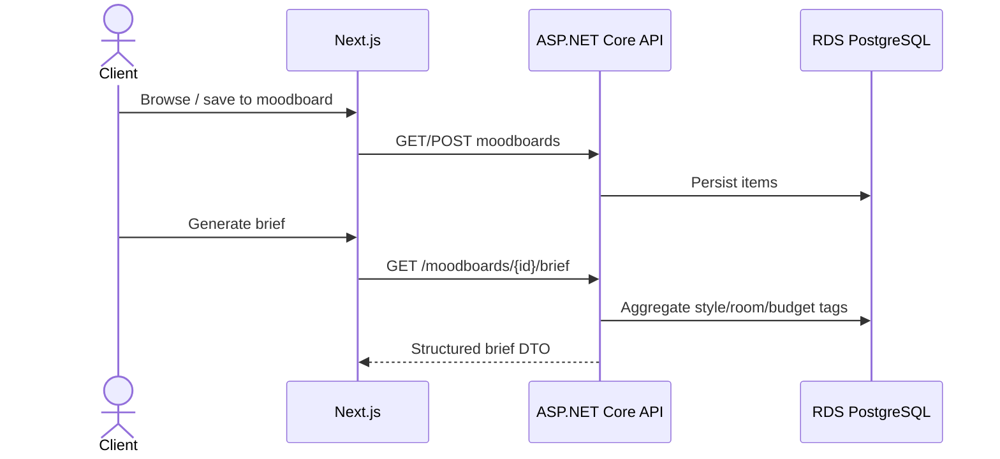
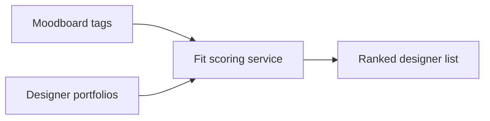
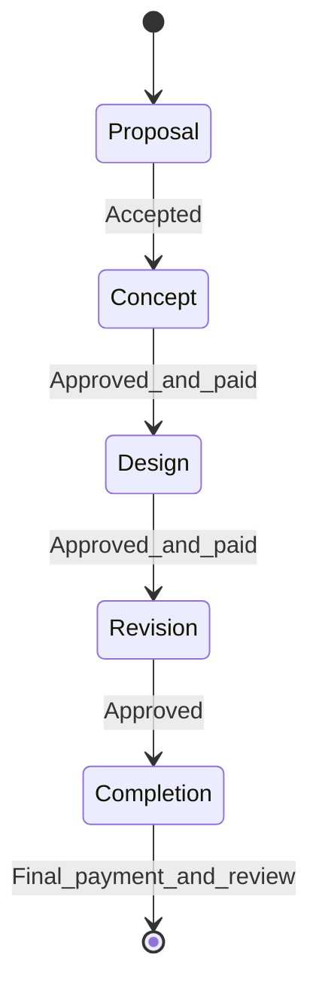
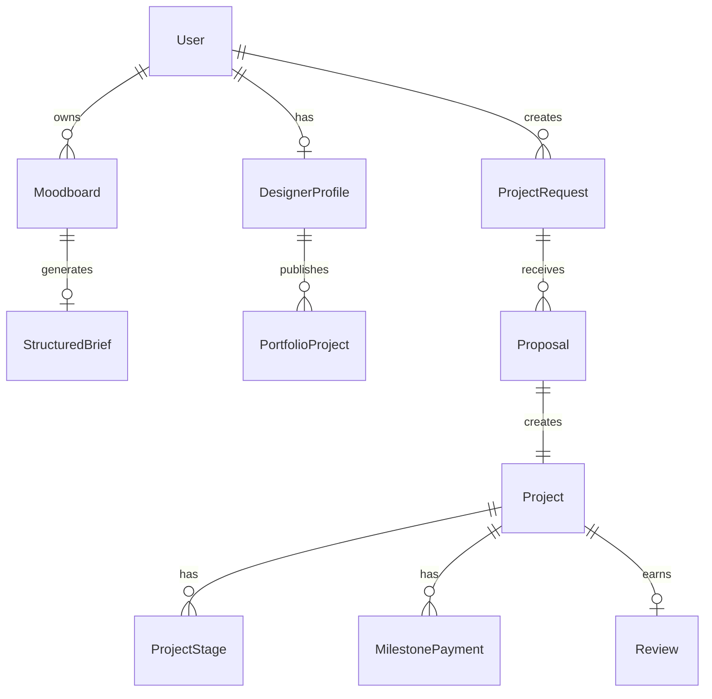

# Inside — System Overview

**What Inside is**, **who uses it**, and **how data flows** from discovery through payment and review.

| Document | Purpose |
|----------|---------|
| Proposal (ELMS) | [Proposal/README.md](Proposal/README.md) |
| Architecture | [Proposal/diagrams/architecture-diagrams.md](Proposal/diagrams/architecture-diagrams.md) |
| Approved topic | [Approval/Topic Approval Documentation.md](Approval/Topic%20Approval%20Documentation.md) |

---

## What is Inside?

**Inside** is a Final Year interior design platform where clients discover designers through **completed room projects**, build **moodboards**, receive an **auto-generated structured brief**, see **designer fit scores**, hire via **proposals**, collaborate in a **stage-gated workspace**, and pay through a **milestone ledger** (Stripe on AWS).

**One-line summary:** Visual brief intelligence + fit scoring + stage-gated delivery—not a generic freelance job board.

---

## Final Year differentiators

| Feature | Description |
|---------|-------------|
| **Structured brief (Layer A)** | Moodboard items → aggregated styles, rooms, budget suggestion |
| **Fit score (Layer B)** | % compatibility between moodboard and each designer’s portfolio |
| **Stage workspace (Layer C)** | Deliverables + approve/reject per stage; chat is secondary |
| **Milestone ledger (Layer D)** | Transparent stage → amount → status → approval history |

---

## Who uses the system?

| Actor | Role |
|-------|------|
| **Guest** | Browse discovery feed (read-only) |
| **Client** | Moodboards, brief, fit scores, requests, approvals, payments, reviews |
| **Designer** | Portfolio, proposals, stage deliverables, availability |
| **Dual-role user** | One account; switch client / designer dashboard |

---

## Core concepts

| Term | Meaning |
|------|---------|
| **Portfolio project** | Room case study: images + style + room type + budget band |
| **Moodboard** | Saved portfolio projects = visual input |
| **Structured brief** | Auto summary derived from moodboard (styles %, rooms, budget band) |
| **Fit score** | 0–100% match between moodboard and designer portfolio |
| **Project request** | Client post with description + moodboard + brief |
| **Proposal** | Designer offer: scope, timeline, price, milestones |
| **Project** | Active job after proposal accepted |
| **Stage** | Proposal → Concept → Design → Revision → Completion |
| **Deliverable** | File for current stage (S3) |
| **Milestone ledger** | Payment record per stage |

---

## End-to-end flow

```mermaid
flowchart LR
    Browse[Browse portfolios] --> Mood[Build moodboard]
    Mood --> Brief[Auto structured brief]
    Brief --> Fit[Designer fit scores]
    Fit --> Request[Post request]
    Request --> Proposals[Proposals]
    Proposals --> Workspace[Stage workspace]
    Workspace --> Ledger[Approve + pay milestone]
    Ledger --> Review[Review]
```



---

## Flow 1 — Discovery and moodboard

1. Client browses **discovery feed** (filter: style, room, budget).
2. Saves projects to **moodboard**.
3. System generates **structured brief** (rule-based tag aggregation in MVP; optional AWS Rekognition labels in stretch).



---

## Flow 2 — Fit scoring

Before posting a request, client views designers ranked by **fit score**:

- Overlap on **design style** tags
- Overlap on **room types**
- **Budget band** alignment



**MVP algorithm (example):** weighted score = 40% style overlap + 35% room overlap + 25% budget match.

---

## Flow 3 — Hire (request + proposals)

1. Client creates **request** (space, budget, notes) + moodboard + brief.
2. Designers submit **proposals**.
3. Client accepts one → **Project** created at stage `Proposal`.

---

## Flow 4 — Stage-gated workspace (primary collaboration)

Workspace UI is organised by **stage tabs**, not a single chat thread.

| Stage | Designer | Client |
|-------|----------|--------|
| Concept | Upload concept boards | Approve / reject + comment |
| Design | Upload design package | Approve / reject |
| Revision | Upload revisions | Approve / reject |
| Completion | Final package | Approve + final payment |

- **Deliverables** uploaded per stage (S3 presigned URLs).
- **Messaging** available for clarification but approval happens on stage panel.
- Optional stretch: image annotation on deliverable.



---

## Flow 5 — Milestone ledger and Stripe

1. Client opens **ledger** for project: stage | amount | status | approved at.
2. Client approves stage → API creates Stripe Checkout / Payment Intent.
3. Webhook confirms payment → stage advances.

Stripe webhooks are authoritative; ledger UI reflects database state.

---

## Flow 6 — Review

After **Completion** and final payment, client submits rating + review on designer profile.

---

## Technology stack

| Layer | Technology |
|-------|------------|
| Frontend | Next.js 14, TypeScript, Tailwind — **AWS Amplify** |
| Backend | **ASP.NET Core 8 Web API** — **ECS Fargate** + ALB |
| Database | **Amazon RDS PostgreSQL** + **EF Core 8** |
| Files | **S3** + **CloudFront** |
| Auth | **AWS Cognito** + JWT claims (client/designer roles) |
| Email | **AWS SES** |
| Payments | **Stripe** |
| Ops | **Secrets Manager**, **CloudWatch**, **GitHub Actions** → ECR |

Details: [Proposal/07-resource-requirements.md](Proposal/07-resource-requirements.md), [Proposal/supporting/technology-justification.md](Proposal/supporting/technology-justification.md).

---

## Repository structure (planned)

```
Inside/
├── src/
│   ├── Inside.Api/
│   ├── Inside.Application/    # BriefService, FitScoringService
│   ├── Inside.Domain/
│   └── Inside.Infrastructure/ # EF Core, S3, Stripe
├── web/                       # Next.js
└── docs/
```

---

## Software modules

| Module | Responsibility |
|--------|----------------|
| Auth | Cognito, dual-role, JWT |
| Discovery | Portfolio feed, filters |
| Moodboard + Brief | Boards, items, brief generation |
| Fit scoring | Rank designers for moodboard |
| Hiring | Requests, proposals, accept |
| Project workflow | Stages, deliverables, approvals |
| Payments | Stripe, milestone ledger |
| Notifications | In-app + SES |
| Reviews | Post-completion ratings |

---

## Data model (simplified)



---

## MVP vs Phase 2

| MVP | Phase 2 |
|-----|---------|
| Rule-based brief + fit score | ML / Rekognition labels |
| HTTP messaging (polling) | WebSocket |
| Stripe test mode | Stripe Connect payouts |
| Stage tabs + file approval | Deliverable annotations |

See [Proposal/supporting/scope-and-limitations.md](Proposal/supporting/scope-and-limitations.md).

---

## Implementation order

1. Auth + dual-role (Cognito)  
2. Portfolio + discovery  
3. Moodboards + **brief generation**  
4. **Fit scoring** + requests/proposals  
5. Stage workspace + S3 deliverables  
6. Stripe ledger  
7. Reviews + notifications  
8. AWS deployment + evaluation  

Matches [Proposal/10-project-plan.md](Proposal/10-project-plan.md).
